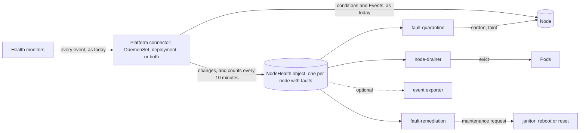
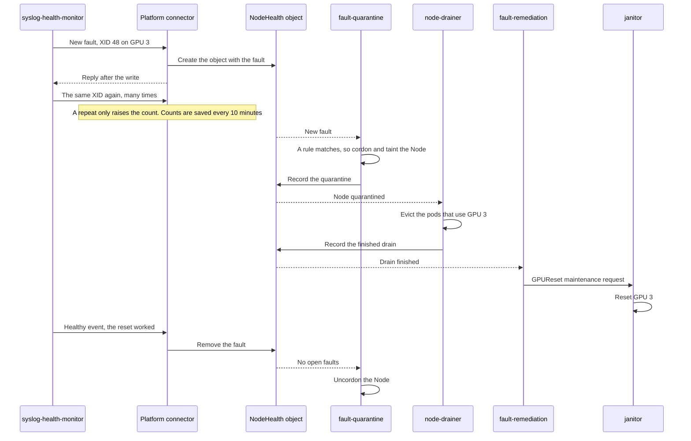
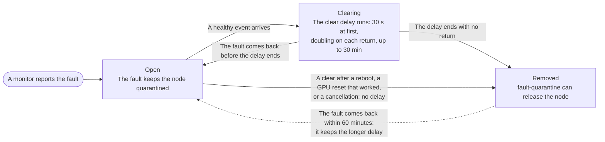

# ADR-063: Kubernetes-Native Remediation Without a Database

## Summary

- **Remediation without a database, as an opt-in mode.** In NodeHealth mode, fault-quarantine, node-drainer and fault-remediation read one small Kubernetes object per node, a `NodeHealth` object, instead of MongoDB or PostgreSQL. No database runs in this mode. The mode is off by default, and existing installs do not change.
- **A NodeHealth object keeps only the faults that are open now, not a history of events.** Only a node with faults has one. A repeated event updates a counter on its open fault, and a cleared fault is removed, so the object never keeps past events. Each consumer records its progress in its own part.
- **Only changes reach the API server.** Monitors keep sending every event, as today. The platform connector creates and updates the NodeHealth objects, and it compares each event with the node's open faults. A repeat of an open fault only raises the fault's count, and the connector saves the counts every 10 minutes by default. So a GPU that logs an XID (a GPU driver error) 600 times a second causes about as few writes as a GPU that logs it once. Each node also has a fixed limit on how much it can write.
- **It works with either platform connector** Everything that matters is stored in the NodeHealth object, and the connector keeps only short-lived data in memory, such as counts that it has not saved yet. So the DaemonSet connector and the deployment platform connector of [ADR-052](052-deployment-platform-connector.md) run the same code, and customers can turn the DaemonSet off.
- **A node is released only on evidence.** Before fault-quarantine removes a node's cordon and taint, a newer write must show that the fault cleared. Most clears must also hold for a short delay, so a fault that keeps coming back keeps the node quarantined. Missing data never releases a node. The existing circuit breaker still limits how many nodes are quarantined.
- **What we give up.** Quarantine rules can no longer match a few rarely used event details. The health-events-analyzer is not supported, and the event exporter and csp-health-monitor need changes before they can run in this mode. In the worst case, one 16 GB etcd that also holds the Node objects supports about 20,000 nodes, or about 35,000 when the circuit breaker's standing limit is set to 10% of GPU nodes (estimate).

Numbers marked "(estimate)" are calculated from the design's fixed write limits, not measured. A scale test will measure them.

## Context

### How remediation works today

Health monitors send their events to the platform connector. It runs as a DaemonSet pod on each node, or as the central deployment platform connector of ADR-052, and it stores each event in MongoDB or PostgreSQL. Three consumers react to each new event in the database: fault-quarantine cordons and taints faulty nodes, node-drainer evicts workloads, and fault-remediation creates the maintenance request that janitor carries out, such as a reboot or a GPU reset. So remediation needs a database, and the default install has neither remediation nor a database.

### Motivation

[Issue #1950](https://github.com/NVIDIA/NVSentinel/issues/1950) names three problems:

1. **Integration cost.** Many new clouds have no managed database, so operators export health events and build their own remediation.
2. **Deployment friction.** A plain Helm install cannot remediate, because the user must also run a second stateful system.
3. **Lost events.** The consumers act on each event once, so a lost event is a fault that is never remediated. Consumers lost events after a requeue and a restart ([#798](https://github.com/NVIDIA/NVSentinel/issues/798)).

NVSentinel's own telemetry shows that floods of XIDs also lose events. On four flooding nodes of one production cluster, the connectors restarted 125 times in one day, and fault-quarantine received only 53% of the events that the connectors received.

The issue proposes one `NodeHealth` object per node, with a counter that goes up on every repeat. That part does not scale: every repeat rewrites the whole object, and etcd keeps each old version for up to 10 minutes, or 15 during an API server failover. One node that repeats an error 120 to 600 times a second would add 245 MB to 1.23 GB of old versions every 10 minutes (estimate).

### Lessons from other projects

Other projects that kept a lot of state in custom resources hit etcd and API server limits. This design avoids each of their mistakes:

| Project | What went wrong | What this design does instead |
|---|---|---|
| Kyverno | It created report objects at the rate of events. 1.6 million objects (9.4 GB) made etcd read-only | The number of NodeHealth objects can never exceed the number of Nodes, and every writer has a write limit |
| Crossplane | Hundreds of CRDs overloaded API servers. Two controllers that fought over one field raised API server load fourfold | One CRD, and one writer for each part of the object |
| Dex | It created more than 500,000 objects in under 24 hours, and its cleanup, which listed them all, timed out | Each idle object is deleted by name, without listing |
| Rancher Fleet | A status list with 7,200 entries hit the 1.5 MiB request limit. An empty cache read as "not found" and uninstalled workloads | No list of nodes inside one shared object. An empty or unsynced cache never releases a node |

The Kubernetes documentation recommends custom resources for state that automation acts on, not for monitoring data. So this design stores only the per-node state that drives cordons, drains and maintenance requests, and never one object per event.

### Requirements

- Run with no database at all, not even an optional one.
- Keep the events that the health monitors send unchanged.
- Stay safe, with a known worst-case cost, from a 3-node cluster to 100,000 nodes, at 10 to 100 times today's peak event rate.
- Work with both the DaemonSet connector as well as the deployment platform connector.
- Fail closed: an error keeps a node quarantined and never releases one.
- Stay backwards compatible: today's database mode stays the default and does not change.

## Decision

We add an opt-in **NodeHealth mode**, selected by the Helm key `global.nodeHealth.mode` (`disabled`, `shadow` or `enabled`; the default is `disabled`). In this mode:

1. Each node that has faults gets one cluster-scoped `NodeHealth` object.
2. Monitors keep sending every event, as today. The platform connector, in either role, creates and updates the NodeHealth objects. It compares each event with the node's open faults, and it writes new faults, changes and clears before it replies to the monitor. For a repeat of an open fault, it only adds to the fault's count, which it saves every 10 minutes by default.
3. The three consumers, fault-quarantine, node-drainer and fault-remediation, read the NodeHealth objects instead of the database. They keep their decision code. Before every cordon, eviction, reboot or reset, they read the current state again.
4. No database runs. The health-events-analyzer, which needs past events, is not supported. The event exporter is changed to read the NodeHealth objects instead of the database, and csp-health-monitor keeps its maintenance events in a new custom resource.



The modules still do not call each other. They meet only in the NodeHealth object, the Node and the maintenance requests.

## Implementation

### Changes in each component

| Component | Change for NodeHealth mode |
|---|---|
| Health monitors | Their events do not change. They keep sending every event in today's format |
| csp-health-monitor | Keeps the maintenance events that it gets from the cloud provider in a new `CSPMaintenanceEvent` custom resource instead of the database. Its existing store interface gets an implementation on these objects, so its logic does not change |
| Platform connector, both roles | A new writer creates and updates the NodeHealth objects. It compares each event with the node's open faults. It writes new faults, changes and clears with a conditional write, within the node's write limit, and marks cleared devices as `Clearing`. For a repeated event it only raises the fault's count, and it saves counts every 10 minutes by default. In both roles it replies to the monitor only after it has written new faults, changes and clears. It handles each event before the optional deduplication stage of ADR-039, which stays as it is for the other connectors. In `enabled` mode it replaces the database writer. Node conditions and Events stay as today |
| fault-quarantine | Reads the NodeHealth objects instead of the database and builds events for its existing rules. It records each quarantine in its own section, times the clear delays, applies the loop limits, and deletes idle objects. Its matching code moves to a shared package. Partial recovery ([ADR-062](062-fault-quarantine-partial-recovery-release.md)) and post-remediation validation ([ADR-049](049-node-validation.md)) keep working |
| node-drainer | Drains the scope that fault-quarantine records, and records each drain in its own section |
| fault-remediation | Starts a remediation only after the drain finished, and records each maintenance request in its own section |
| janitor | No change. It still carries out the maintenance requests |
| Event exporter | Watches the NodeHealth objects and sends each change, instead of reading the database |
| health-events-analyzer | Not supported in this mode |
| Helm chart | Adds the `global.nodeHealth.mode` key, the NodeHealth and CSPMaintenanceEvent CRDs, RBAC and admission policies. In `enabled` mode it runs no database and does not install the analyzer |

### The NodeHealth object

A NodeHealth object is named after its Node and owned by it, so there is at most one per live Node, and deleting the Node deletes it. It has two kinds of parts:

- **Fault sections in `spec`, written by the connector.** `spec.node` holds faults from monitors that run on the node, such as syslog-health-monitor. `spec.central` holds faults from cross-node monitors, such as csp-health-monitor or lifecycle-manager.
- **Consumer sections in `status`.** Each of the three consumers writes only its own section, to record what it did.

An object with one fault is about 2 KB. The connectors limit the metadata and the fault sections to 12 KiB. With the consumer sections, a quarantined object at that limit is about 20 KB.

**Example.** Node `gpu-node-17` has two open faults:

1. GPU 3 logged XID 48, a fatal memory error that calls for a GPU reset. The node is quarantined, the pods that use GPU 3 are evicted, and the GPU reset is running.
2. The cross-node monitor lifecycle-manager reported planned host maintenance for the node, which fault-quarantine has not handled yet.

```yaml
apiVersion: healthevents.dgxc.nvidia.com/v1alpha1
kind: NodeHealth
metadata:
  name: gpu-node-17                             # the Node's name
  generation: 14                                # set by the API server: +1 on every change to spec
  ownerReferences:                              # exactly one: the Node, so deleting the Node deletes this object
  - {apiVersion: v1, kind: Node, name: gpu-node-17, uid: 78ff5c0a-e565-4211-8378-6ddb47ee2a6b}
spec:
  node:                                         # faults from monitors that run on gpu-node-17
    bootID: 4f2c9a10-3e71-4a55-9c3e-8d1b2f7a6e04   # the node's boot at the last write, read from the Node object
    bootGeneration: 9                           # generation of the first change in this boot
    allowance:                                  # how much of the node's write limit is left
      urgentBytes: 28312
      normalBytes: 13312
      updatedAt: "2026-09-16T12:39:26Z"
      counterSavedAt: "2026-09-16T13:05:01Z"
    recentlyClosed: []                          # devices removed in the last 60 minutes, with their flap counts
    faults:
    - agent: syslog-health-monitor
      componentClass: GPU
      check: SysLogsXIDError
      version: 1
      errorCode: "48"
      isFatal: true                             # stays true while the fault is open
      recommendedAction: COMPONENT_RESET        # the most severe action seen while open
      message: "NVRM: Xid (PCI:0002:00:01): 48, pid=4123, name=python, DBE (0x00000002)" # the first occurrence
      count: 7                                  # about 7 occurrences, saved every 10 minutes
      devices:
      - entities:
        - {type: GPU_UUID, value: GPU-67fec4a7-a3e1-385c-0c98-4361b4a372ca}
        - {type: PCI, value: "0002:00:01"}
        generation: 12                          # generation of this device's latest change
        state: Open                             # Open, or Clearing while a clear delay runs
        flaps: 0                                # times the fault came back after a clear
        since: "2026-09-16T12:39:26Z"
  central:                                      # faults from cross-node monitors
    allowance: {urgentBytes: 30208, updatedAt: "2026-09-16T13:10:00Z"}
    faults:
    - agent: lifecycle-manager
      componentClass: Node
      check: MaintenanceRequest
      version: 1
      errorCode: ""
      isFatal: true
      recommendedAction: RESTART_VM
      attributes: {maintenanceRequestName: mr-gpu-node-17-7f3a}   # allow-listed metadata only
      message: "Scheduled host maintenance"
      count: 1
      devices:
      - {generation: 14, state: Open, flaps: 0, since: "2026-09-16T13:10:00Z"}   # no entities: the whole node
status:
  faultQuarantine:
    state: Quarantined                          # Quarantined, WouldQuarantine (dry run) or Released
    sessionID: 7c0e8f52-3b1d-4c47-9a35-0d6e1f2b8a94
    observedGeneration: 13                      # generation 14 is not handled yet
    held:                                       # devices that keep the node quarantined
    - {check: SysLogsXIDError, errorCode: "48", device: GPU_UUID=GPU-67fec4a7-a3e1-385c-0c98-4361b4a372ca}
    requarantines: []                           # re-quarantines after someone else uncordoned the node
  nodeDrainer:
    sessionID: 7c0e8f52-3b1d-4c47-9a35-0d6e1f2b8a94
    drains:                                     # one entry per drain scope
    - {scope: GPU_UUID=GPU-67fec4a7-a3e1-385c-0c98-4361b4a372ca, state: Succeeded, startedAt: "2026-09-16T12:40:01Z"}
  faultRemediation:
    sessionID: 7c0e8f52-3b1d-4c47-9a35-0d6e1f2b8a94
    remediations:                               # one entry per target
    - {target: GPU_UUID=GPU-67fec4a7-a3e1-385c-0c98-4361b4a372ca, attempt: 1, startedGeneration: 12}
```

How to read the example:

1. The object is at generation 14. The XID 48 fault opened on GPU 3 at generation 12, and the first change in the current boot was at generation 9, so the fault opened in this boot. Generation 13 only saved the count.
2. fault-quarantine handled the object up to generation 13, and GPU 3 is in its `held` list. It releases the node only after a newer generation no longer contains the fault.
3. The maintenance fault arrived at generation 14, which fault-quarantine has not handled yet.
4. The drain of GPU 3 finished. The first GPU reset is running: fault-remediation started it at generation 12, and janitor carries out the `GPUReset` maintenance request.

### NodeHealth fields

The object stores nothing that can be derived from other data. There is no summary of the faults, no history of remediations and no separate change counter. Most fields explain themselves, and the comments in the example cover the rest. These fields need more explanation:

| Field | Meaning |
|---|---|
| `metadata.generation` and each device's `generation` | The API server raises the object's generation by 1 on every change to `spec`. The connector writes the generation of each device's latest change into the device, and fault-quarantine records the last generation it handled in `observedGeneration`. So the consumers can order changes without comparing clocks |
| `bootID`, `bootGeneration` | Node section only. The node's boot at the last write, which the connector reads from the Node object, and the generation of the first change in that boot. They show whether a fault opened before or after the last reboot |
| `allowance` | How much of the node's write limit is left. It is stored in the object, so all connector replicas share one limit, also after a restart |
| `state`, `flaps`, `recentlyClosed` | `Clearing` means that the clear delay runs, and the device still keeps the node quarantined. `flaps` counts how often the fault came back after a clear, and each return doubles the next delay. `recentlyClosed` keeps the flap counts of devices removed in the last 60 minutes |
| `faultQuarantine.held` | The devices that keep the node quarantined. node-drainer and fault-remediation take the action and the drain scope from the matching fault |
| `faultRemediation.remediations` | One entry per remediation target, with the attempt number and the generation at which it started. The name of the maintenance request is derived from the session, the target and the attempt, so fault-remediation can always find the request again |

### Who writes each part

- The connector writes the fault sections, and each consumer writes only its own consumer section. Role-based access control (RBAC) and admission policies enforce this split.
- ADR-052's node binding ties each monitor's token to its node, so a monitor that runs on a node can report only about that node. One exception: when cross-node monitors publish through the DaemonSet connector, its pods may also write other nodes' central faults, so a compromised node could write them too. Today every connector pod already holds a database credential that can write events for any node.
- Every write is a conditional write: it fails if the object changed after the writer read it. This is the standard Kubernetes check on `metadata.resourceVersion`, so no writer overwrites a change that it has not seen.

**How the consumers use the NodeHealth object.** Each consumer acts on the faults in `spec` and on live state: the Node, its pods and the maintenance requests. It writes its own part of `status` only to record what it did, such as the quarantine, its drains and the requests it created. The next consumer reads that part to pick up the work, as the Deployment controller reads ReplicaSet status. Before any cordon, eviction, reboot or reset, a consumer reads the object and the Node again from the API server, not from its cache. If `status` is lost, for example after a restore, the faults in `spec` still hold the node, so the design fails closed.

The connector keeps writing Node conditions and Events in today's format, because other tools read them, but only when a fault changes.

### Example: one GPU fault from detection to recovery

GPU 3 on node `gpu-node-17` logs XID 48, a memory error that calls for a GPU reset.



The diagram leaves out a few details. To decide on the quarantine, fault-quarantine builds an event from the object and runs its existing rules on it. Before it creates the maintenance request, fault-remediation reads the object and the Node again from the API server. When the node has had no faults for 24 hours, fault-quarantine deletes the object.

### Handling repeated errors

Monitors keep sending every event, as today. For each event, the connector looks for an open fault in the node's NodeHealth object that matches it. It uses the matching code of fault-quarantine, which moves to a shared package, so the connector and fault-quarantine agree on what counts as the same fault. Then:

- **A new or worse fault** is written to the object at once, before the connector replies to the monitor.
- **A repeat of an open fault** only adds 1 to the fault's count in the connector's memory. The connector saves the counts to the object every 10 minutes by default, or earlier when it writes the object for another reason.

**Why the count is not saved on every repeat.** A patch that changes only the count is small to send. But the API server still writes the whole object to etcd as a new version, and it sends the whole object to every watcher. So one patch per repeat would bring back the problem of the issue's counter: a node that repeats an error 600 times a second would cause 600 full writes a second. No decision uses the count, so a count that is a few minutes old costs nothing. Kubernetes Events work the same way: after the first event of a series, repeats cause no API calls, and a heartbeat updates the count every 30 minutes ([KEP-383](https://github.com/kubernetes/enhancements/tree/master/keps/sig-instrumentation/383-new-event-api-ga-graduation)).

**The save interval is a setting.** The Helm key `global.nodeHealth.countSaveInterval` is 10 minutes by default. A shorter interval keeps counts fresher, and a restart loses fewer repeats, but saving counts costs more. At 1 minute, saving counts costs 10 times as much etcd history as at 10 minutes. A longer interval costs less, but the counts are older. The support table under [Scale and etcd usage](#scale-and-etcd-usage) assumes 10 minutes.

**What a restart loses.** Counts that the connector has not saved yet exist only in its memory. If the connector restarts, it loses them, so a count can end up lower than the real number, by at most one save interval of repeats. The faults themselves are never lost. In both roles the connector writes every new fault, change and clear before it replies, and the monitor keeps each event until the reply. Today's DaemonSet connector replies as soon as an event is in its memory queue, so a crash there can lose whole events, including new faults and clears. A batch that a monitor sends twice can also be counted twice, so a count is approximate in both directions.

The writer handles each event before the optional deduplication stage of [ADR-039](039-health-event-deduplication.md), which is off by default. That stage never drops an event. It only marks a repeated syslog XID event `STORE_AND_ANALYSE`, so that the Node conditions ignore it. Because the writer sees each event as the monitor sent it, before any mark, it counts every repeat. A stale mark also cannot hide a fault that came back, for example when a replica of the deployment platform connector missed the clear. The stage keeps working as today for the other connectors.

The connector writes only when something changes. Each node may write only a fixed amount per time period, and the NodeHealth object stores how much is left. So every connector replica sees the same limit, also after a restart. A node with one fault can make about 17 writes for new, worse or returning faults at once, then one about every 35 seconds (estimate).

For example, a node that floods XID 137 and 145 at 120 to 600 events per second for 11 hours costs 1 or 2 writes at the start, then 1 every 10 minutes. That is about 7.4 KB of etcd history, instead of up to 1.23 GB with the issue's design (estimate). As today, the connector receives every event, but it handles a repeat in memory instead of writing it to a database.

### Clearing faults and handling flapping devices

A healthy event clears the matching faults. Most clears then wait a short **clear delay** before fault-quarantine acts on them. The delay starts at 30 seconds and doubles each time the fault comes back, up to 30 minutes, so a device that keeps flapping keeps its node quarantined. A clear after a reboot, a report that a GPU reset worked, and a monitor that withdraws its own fault ([ADR-038](038-health-monitor-cancellation-rules.md)) skip the delay.

The connector marks a cleared device as `Clearing` in the NodeHealth object, and fault-quarantine times the delay. This works for every monitor, because the object sees every return of a fault, whichever monitor reports it. After the delay, the connector removes the device but keeps its flap count for 60 minutes in `recentlyClosed`. So a fault that comes back within that hour opens with the longer delay, and a device that flaps slowly also gets longer and longer delays.



The connector applies each monitor's events in the order they arrive, not by their timestamps. After a reboot, syslog-health-monitor first sends a clear and then reads the new boot's log from the start, so a new XID can carry an earlier time than the clear. Because the XID arrives after the clear, it reopens the fault.

### Safety rules

- **Release only on evidence.** Before fault-quarantine releases a node, a newer write must no longer contain its faults, or their clear delays must have passed with no return. A missing, unsynced or re-created object releases nothing.
- **Re-check before acting.** Each consumer reads the object and the Node again before it acts. A remediation starts only after the drain finished and only for a fault that is still open, and fault-remediation never retries on a timer.
- **Circuit breaker.** The circuit breaker of [ADR-022](022-circuit-breaker-reset-mechanism.md) and its settings decide how many nodes fault-quarantine quarantines, as today. NodeHealth mode adds no limits of its own on quarantines, drains or remediations. The breaker's standing limit, `circuitBreaker.maxCordonedPercentage`, is off by default. Large clusters should set it, as [Scale and etcd usage](#scale-and-etcd-usage) shows.
- **No fight with other automation.** If someone else uncordons a node while its fault is open, the fault's next report quarantines it again. After 3 such re-quarantines in 24 hours, fault-quarantine stops acting on the node and marks it with an annotation. The node then runs with its fault open until an operator removes the annotation.
- **Safe restarts.** Every step is safe to repeat, and each consumer records what it will do before it does it. A crash test restarts each component after each write and checks the result.
- **A full etcd.** When etcd is full, no new cordon, drain or maintenance request starts.

### Partial recovery and post-remediation validation

Two fault-quarantine features change when a node's cordon and taints come off. Both keep working in NodeHealth mode:

- **Releasing actions on partial recovery ([ADR-062](062-fault-quarantine-partial-recovery-release.md)).** With this opt-in setting, when one fault clears and others stay open, fault-quarantine removes each taint and the cordon that no open fault needs. In NodeHealth mode it evaluates its rules on the faults that are still open in the NodeHealth object, and a `Clearing` fault still counts as open. As in ADR-062, nothing comes off early when an evaluation fails or when the quarantine needs validation. If the cordon comes off, fault-quarantine starts a new session, so drains that finished before no longer count, and node-drainer drains the node again before any later reboot or reset.
- **Post-remediation validation ([ADR-049](049-node-validation.md)).** A NodeHealth object drops a fault once it clears, so fault-quarantine records, while the quarantine runs, which faults need validation. When the last fault clears, it creates the `ValidationRequest` and leaves the cordon and taints for lifecycle-manager, which removes them after validation passes, as today.

### Changes for fault-quarantine rules

The event that fault-quarantine gives its rules has the same 18 fields as today, and all 8 shipped rulesets keep matching. But rules can no longer select on:

- the message text of later occurrences, because the object keeps the first message,
- event metadata outside an allow-list,
- informational faults, unless `recordInformational: true` is set,
- more than 8 entities per device, which affects XID 74 events,
- faults beyond the size limit, which merge into one overflow entry that still keeps the node quarantined,
- two error codes of one event together, because each code becomes its own fault. No shipped monitor or ruleset does this.

A validator reports the affected rules in each ruleset, including custom rulesets. Their owners must accept each loss before they turn on NodeHealth mode.

### Other components that use the database

Three components use the database today for more than remediation.

- **health-events-analyzer: not supported.** It finds patterns over time, such as an XID that repeats many times in a day, and 15 of its 22 default rules need past events. A NodeHealth object keeps only the faults that are open now, so the analyzer cannot run in NodeHealth mode, and the chart does not install it. Installs that need the analyzer stay in database mode.
- **Event exporter: needs a change.** It reads new events from the database and sends them to an HTTP endpoint ([ADR-012](012-health-events-exporter.md)). To run in NodeHealth mode, it must be changed to watch the NodeHealth objects instead, and to send each change, such as a new fault, a new count or a clear. It then sends changes and counts, not every repeated event.
- **csp-health-monitor: moves its store to a custom resource.** It polls the cloud provider for planned maintenance, and it keeps each maintenance event and its status in the database. In NodeHealth mode it keeps them in a new `CSPMaintenanceEvent` custom resource instead: one object per maintenance event, with the same fields as the database record. Its existing store interface gets an implementation on these objects, so neither its logic nor its maintenance-notifier sidecar changes. A ConfigMap keeps how far it has read each cloud provider's events, and each object is deleted 7 days after its maintenance finished. So there are only about as many objects as nodes with planned or recent maintenance.

### Scale and etcd usage

The etcd cost grows with the number of nodes and with how often faults change, not with how many events the monitors see. In the worst case every node uses its full write limit, every clear comes back, and every consumer works at full speed. The worst case also depends on the circuit breaker, because every quarantined node also carries the consumers' records. With the breaker's defaults, which have no standing limit, every GPU node can end up quarantined, and the worst case at 100,000 nodes is about 33 GB (estimate). With the standing limit set to 10% of GPU nodes (`circuitBreaker.maxCordonedPercentage: 10`), it is about 17 GB. A 16 GB etcd has less than either left after it stores the Node objects ([#1705](https://github.com/NVIDIA/NVSentinel/issues/1705)). One fault on each of 100,000 nodes costs only about 0.61 GB (estimate).

| etcd size | Largest cluster with the breaker's defaults (estimate) | Largest cluster with a 10% standing limit (estimate) |
|---|---|---|
| 2 GiB (self-managed) | About 2,300 to 2,600 nodes | About 4,000 to 4,800 nodes |
| 8 GB (EKS standard, AKS) | About 9,800 to 10,700 nodes | About 17,200 to 20,000 nodes |
| 16 GB (EKS Provisioned) | About 20,000 to 21,900 nodes | About 35,200 to 40,800 nodes |
| 20 GB (EKS ultra-scale, Node objects stored apart) | About 27,000 to 29,700 nodes | About 50,400 to 59,700 nodes |

Each row gives the largest cluster whose worst case fits in half of the etcd space that the Node objects leave. The other half stays free for the rest of the cluster. The ranges cover 10 and 15 minutes of etcd history. Larger clusters need a provider that splits etcd storage or replaces etcd.

### Turning the mode on and off

- **A new install without a database** sets the mode to `enabled` directly.
- **An existing install with a database** moves in two steps. In `shadow`, the connectors write NodeHealth objects next to the database, which stays the source of truth. A Job copies today's open faults, and fault-quarantine reports where its decisions would differ. When the differences are explained and the rule owners signed off, `enabled` switches the consumers to the NodeHealth objects. Quarantined nodes stay quarantined. After the switch nothing reads the database, so it can be removed.
- **Rollback** needs a database again. The consumers switch back to it, and a Job publishes every open fault to it.

## Rationale

- **Each node's open faults are stored, not every event.** The number of NodeHealth objects grows with the number of nodes that have faults, and the number of writes grows with how often faults change. The projects that hit etcd limits stored one object per event, or rewrote an object on every repeat.
- **Faults go in `spec`, and consumer progress goes in `status`.** Creating an object with its faults in `spec` takes one write, and `status` would need a second. Consumer writes to `status` do not change `metadata.generation`, so a consumer can tell a fault change from another consumer's write. RBAC can then separate the connector from the consumers, which the Kubernetes proposal [KEP-2527](https://github.com/kubernetes/enhancements/tree/master/keps/sig-architecture/2527-clarify-status-observations-vs-rbac) names as the reason for the split. A restore that drops `status`, as [Velero](https://velero.io/docs/main/restore-reference/) does by default, cannot drop open faults. Lease, CSINode and ResourceSlice also keep what node agents report in `spec` or at the top level.
- **Monitors keep their contract, and the connector does the counting.** Monitors send the same events as today, so no monitor and no event format changes. The connector already receives every event in both roles, so it is the right place to compare an event with the open faults and update only the count. Its memory holds only short-lived data, such as the counts that it has not saved yet. Everything else lives in the NodeHealth object, so any connector replica can handle any event. Kubernetes treats repeated Events the same way: it keeps one Event with a count instead of one object per repeat, and it limits how often a source writes ([kubernetes#47367](https://github.com/kubernetes/kubernetes/pull/47367)).
- **Releasing a node is the risky action, so it needs evidence.** A wrong release puts a faulty GPU back into service. Stale reads are the largest class of controller bugs ([Sieve](https://www.usenix.org/system/files/osdi22-sun.pdf): 19 of 46). Releasing only on evidence, conditional writes and fresh reads before each action close those paths.
- **The existing decision code stays.** The decision code and the matching code of fault-quarantine do not change, so its rules and tests carry over.

## Consequences

### Positive

- Remediation works without MongoDB or PostgreSQL. A plain Helm install can remediate, and a database outage can no longer stop remediation.
- During XID floods, the connector writes only changes and a count every 10 minutes, instead of one database write per event.
- The events that monitors send, including custom monitors, do not change.
- The same design works with the DaemonSet connector, the deployment platform connector or both, so customers can turn the DaemonSet off.
- A connector crash can no longer lose a fault or a clear, because both roles write them before they reply. Today the DaemonSet connector replies before it writes.
- The consumers act on the faults that are open now. After a restart they read the current NodeHealth objects instead of replaying old events, so a missed event no longer means a missed fault.
- Operators can see each node's open faults with `kubectl get nh`.

### Negative

- Quarantine rules can no longer match a few event details, such as the text of later messages or metadata outside an allow-list. Some custom rulesets may need changes.
- There is no event history. A NodeHealth object keeps only open faults, and fault-quarantine deletes it one day after the last fault clears. Investigations must rely on the exported changes or on logs.
- The health-events-analyzer cannot run, so patterns over time are not detected, such as an XID that keeps coming back or a node that needs remediation again and again. Installs that need it stay in database mode.
- The event exporter and csp-health-monitor need code changes before they can run in this mode.
- Counts are approximate. A connector restart loses up to one save interval of repeats, and a batch that a monitor sends twice can be counted twice.
- A node that has many faults and has used its write limit must wait before it writes again. In the worst case a clear waits up to about 36 minutes, which keeps the node quarantined longer, and a new fatal fault waits up to about 6 minutes before fault-quarantine sees it (estimate).
- After someone else uncordons a node, fault-quarantine quarantines it again only when the fault is reported again.
- One etcd cannot hold the worst case for 100,000 nodes, and large clusters need the circuit breaker's standing limit to stay within the support table. The API server's memory use is unknown until the scale test.
- The NodeHealth object type becomes a public interface that must stay backwards compatible.
- The consumers must support both the database and the NodeHealth objects, because database mode stays.
- When the DaemonSet is off, every write goes through the deployment platform connector, which ADR-052 still marks experimental.

## Alternatives Considered

### A counter that changes on every repeat (the issue's proposal)

**Rejected** because the counter rewrites the whole object on every repeat, as described under [Motivation](#motivation). This design keeps the issue's core idea: one object per node that holds current state.

### One object per health event (ADR-027)

**Rejected** because the number of objects follows the event rate, which is how Kyverno filled etcd. Even one object per open fault would reach 1.6 million objects at 100,000 nodes with 16 faults each (estimate).

### A separate datastore (SQLite, kine or an aggregated API)

**Rejected** for the first release, because each one adds another stateful system that can fail. The kine project stores Kubernetes objects in a SQL database instead of etcd. SQLite allows only one writer, so one pod becomes a single point of failure. A separate store stays the fallback if the scale test fails.

### An OpenTelemetry backend as the datastore

**Rejected** because these backends have no watch and no in-place update, and an outage of the observability stack would stop remediation. Exporting events to such a backend for analysis stays possible.

## References

- NVSentinel: [issue #1950](https://github.com/NVIDIA/NVSentinel/issues/1950); [ADR-027](027-kubernetes-data-store.md) (superseded by this record) and its series [#640](https://github.com/NVIDIA/NVSentinel/pull/640), [#787](https://github.com/NVIDIA/NVSentinel/pull/787), [#882](https://github.com/NVIDIA/NVSentinel/pull/882), [#970](https://github.com/NVIDIA/NVSentinel/pull/970); [ADR-012](012-health-events-exporter.md); [ADR-052](052-deployment-platform-connector.md); issues [#798](https://github.com/NVIDIA/NVSentinel/issues/798), [#1705](https://github.com/NVIDIA/NVSentinel/issues/1705); the `HealthEvent` prototype [#795](https://github.com/NVIDIA/NVSentinel/pull/795)
- Related records: [ADR-022](022-circuit-breaker-reset-mechanism.md), [ADR-039](039-health-event-deduplication.md), [ADR-049](049-node-validation.md) and [ADR-062](062-fault-quarantine-partial-recovery-release.md) keep working in NodeHealth mode. In NodeHealth mode, per-node work replaces the priority queue of [ADR-041](041-node-drainer-priority-queue.md), and database mode keeps it as it is.
- Kubernetes: [custom resources](https://kubernetes.io/docs/concepts/extend-kubernetes/api-extension/custom-resources/); [KEP-2527](https://github.com/kubernetes/enhancements/tree/master/keps/sig-architecture/2527-clarify-status-observations-vs-rbac); [KEP-383](https://github.com/kubernetes/enhancements/tree/master/keps/sig-instrumentation/383-new-event-api-ga-graduation); [event spam filter #47367](https://github.com/kubernetes/kubernetes/pull/47367); stalled node-health proposals [KEP-4212](https://github.com/kubernetes/enhancements/issues/4212), [KEP-5233](https://github.com/kubernetes/enhancements/issues/5233), [KEP-5283](https://github.com/kubernetes/enhancements/issues/5283), [KEP-5770](https://github.com/kubernetes/enhancements/issues/5770)
- Lessons from other projects: [Kyverno #8974](https://github.com/kyverno/kyverno/issues/8974) and [reports-server](https://github.com/kyverno/reports-server); [Crossplane #2649](https://github.com/crossplane/crossplane/issues/2649) and [#5458](https://github.com/crossplane/crossplane/issues/5458); [Dex #1292](https://github.com/dexidp/dex/issues/1292); [Rancher Fleet #3482](https://github.com/rancher/fleet/issues/3482) and [#5406](https://github.com/rancher/fleet/issues/5406); [Sieve](https://www.usenix.org/system/files/osdi22-sun.pdf); [Velero restore reference](https://velero.io/docs/main/restore-reference/)
- Storage and scale: [EKS Provisioned Control Plane](https://docs.aws.amazon.com/eks/latest/userguide/eks-provisioned-control-plane.html); [EKS ultra-scale](https://aws.amazon.com/blogs/containers/under-the-hood-amazon-eks-ultra-scale-clusters/)
