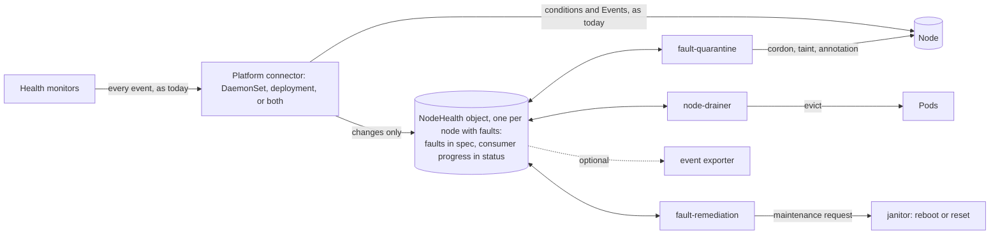
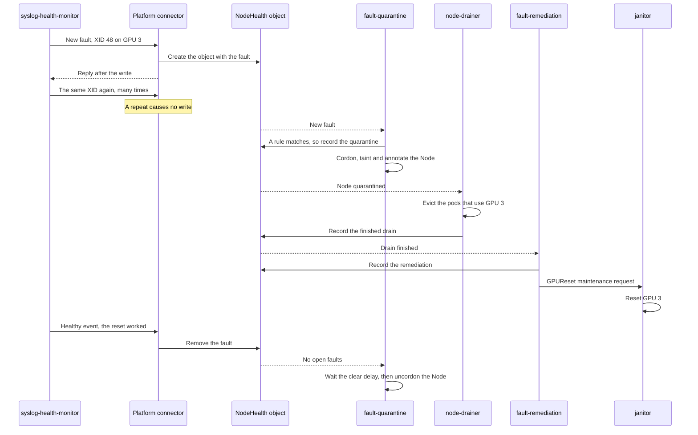
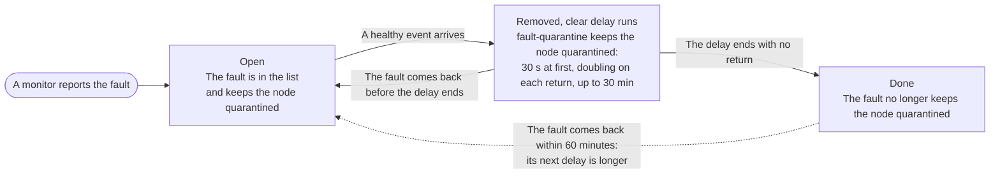

# ADR-066: Kubernetes-Native Remediation Without a Database

## Summary

- **Remediation without a database, as a new datastore option.** In Kubernetes mode, which `global.datastore.provider: kubernetes` selects, fault-quarantine, node-drainer and fault-remediation read one small Kubernetes object per node with faults, a `NodeHealth` object, instead of MongoDB or PostgreSQL. No database runs in this mode. The default does not change, so existing installs are not affected.
- **A NodeHealth object keeps only the faults that are open now, not a history of events.** A cleared fault is removed, and a repeated event adds nothing, so the object never keeps past events. Each of the three consumers records its progress in its own section.
- **Only changes are written to the NodeHealth objects.** Monitors keep sending every event, as today. The platform connector compares each event with the node's open faults, and a repeat causes no write. So a GPU that logs an XID (a GPU driver error) 600 times a second causes as few writes as a GPU that logs it once. Each node also has a fixed limit on how much it can write.
- **All code for the NodeHealth objects is in one store-client provider.** The new `kubernetes` provider sits next to the MongoDB and PostgreSQL providers, and each module runs it in its own process, with no proxy in between. It builds today's events from the open faults, so the consumers keep their decision code.
- **It works with either platform connector.** Everything that matters is stored in the NodeHealth object, and the connector keeps nothing in memory that it needs after a restart. As a result, the DaemonSet connector and the deployment platform connector of [ADR-052](052-deployment-platform-connector.md) run the same code, and customers can turn the DaemonSet off.
- **A node is released only on evidence.** Before fault-quarantine removes a node's cordon and taints, a newer write must show that the fault cleared. Each clear must also hold for a short delay, so a fault that keeps coming back keeps the node quarantined. Missing data never releases a node. The existing circuit breaker still limits how many nodes are quarantined.
- **What we give up.** Quarantine rules can no longer match a few rarely used event details that a NodeHealth object does not keep, such as the event message ([list](#changes-for-fault-quarantine-rules)). The health-events-analyzer is not supported, and the event exporter and csp-health-monitor need changes before they can run in this mode. In the worst case, one 16 GB etcd that also holds the Node objects supports more than 21,000 nodes (estimate). If the circuit breaker caps quarantined nodes at 10% of GPU nodes, it supports more than 36,000 (estimate).

Numbers marked "(estimate)" are calculated from the design's fixed write limits, not measured. A scale test will measure them.

## Context

### How remediation works today

Health monitors send their events to the platform connector. It runs as a DaemonSet pod on each node, or as the deployment platform connector of ADR-052, and it stores each event in MongoDB or PostgreSQL. Three consumers react to each new event in the database: fault-quarantine cordons and taints faulty nodes, node-drainer evicts workloads, and fault-remediation creates the maintenance request that janitor carries out, such as a reboot or a GPU reset. So remediation needs a database.

### Motivation

[Issue #1950](https://github.com/NVIDIA/NVSentinel/issues/1950) names three problems:

1. **Integration cost.** Many new clouds have no managed database, so operators export health events and build their own remediation.
2. **Deployment friction.** A plain Helm install cannot remediate, because the user must also run a second stateful system.
3. **Lost events.** The consumers act on each event once, so a lost event is a fault that is never remediated. Consumers lost events after a requeue and a restart ([#798](https://github.com/NVIDIA/NVSentinel/issues/798)).

NVSentinel's own telemetry shows that floods of XIDs also lose events. On four flooding nodes of one production cluster, the connectors restarted 125 times in one day, and fault-quarantine received only 53% of the events that the connectors received.

### Lessons from other projects

Other projects that kept a lot of state in custom resources hit etcd and API server limits. This design avoids each of their mistakes:

| Project | What went wrong | What this design does instead |
|---|---|---|
| Kyverno | It created report objects at the rate of events. 1.6 million objects (9.4 GB) made etcd read-only ([kyverno#8974](https://github.com/kyverno/kyverno/issues/8974)) | The number of NodeHealth objects can never exceed the number of Nodes, and the connector has a write limit for each node |
| Crossplane | Hundreds of CRDs overloaded API servers ([crossplane#2649](https://github.com/crossplane/crossplane/issues/2649)). Two controllers that fought over one field raised API server load fourfold ([crossplane#5458](https://github.com/crossplane/crossplane/issues/5458)) | Two new CRDs, and one writer for each section of a NodeHealth object |
| Dex | It created more than 500,000 objects in under 24 hours, and its cleanup, which listed them all, timed out ([dex#1292](https://github.com/dexidp/dex/issues/1292)) | Each idle object is deleted by name, without listing |
| Rancher Fleet | A status list with an entry for every resource on about 70 clusters went over etcd's request size limit ([fleet#3482](https://github.com/rancher/fleet/issues/3482)). An empty cache read as "not found" and uninstalled workloads ([fleet#5406](https://github.com/rancher/fleet/issues/5406), fixed in [fleet#5585](https://github.com/rancher/fleet/pull/5585)) | No list of nodes inside one shared object. An empty or unsynced cache never releases a node |

The Kubernetes documentation describes the best fit for custom resources as a relatively small number of relatively small objects that change relatively infrequently ([Declarative APIs](https://kubernetes.io/docs/concepts/extend-kubernetes/api-extension/custom-resources/#declarative-apis)). So this design stores one small object per node with faults, writes it only when something changes, and never stores one object per health event.

## Decision

We add **Kubernetes** as a third datastore option, next to MongoDB and PostgreSQL. It is selected with `global.datastore.provider: kubernetes`, and the default does not change. In this mode:

1. Each node that has faults gets one cluster-scoped `NodeHealth` object.
2. Monitors keep sending every event, as today. The platform connector, in either role, creates and updates the NodeHealth objects. It compares each event with the open faults in the node's NodeHealth object, and it writes new faults, changes and clears before it replies to the monitor. A repeat of an open fault causes no write, except its first report after a reboot, a finished remediation attempt or an uncordon.
3. The three consumers, fault-quarantine, node-drainer and fault-remediation, read the NodeHealth objects instead of the database. The store-client provider builds today's events from the open faults, so their decision code does not change. Before every cordon, eviction, reboot or reset, they read the current state again. A node is released only when a newer write shows that its faults cleared and their clear delays passed.
4. No database runs. The health-events-analyzer, which needs past events, is not supported. The event exporter is changed to read the NodeHealth objects instead of the database, and csp-health-monitor keeps its maintenance events in a new custom resource.
5. All code that reads or writes NodeHealth objects is in the `kubernetes` provider of store-client, next to the MongoDB and PostgreSQL providers. Each module runs it in its own process, so no new component stands between the modules and the API server ([why not a proxy](#a-store-proxy-deployment)).



The modules still do not call each other. They meet only in the NodeHealth object, the Node and the maintenance requests.

## Implementation

### The NodeHealth object

A NodeHealth object is named after its Node and owned by it, so there is at most one per live Node, and deleting the Node deletes it. A small cleanup controller deletes an object about an hour after its last change, when no fault is open ([Deleting idle objects](#deleting-idle-objects)). Each object has two kinds of sections:

- **Open faults in `spec`, written by the connector.** `spec.publishers` has one entry per monitor (`agent`), with that monitor's open faults. Faults from monitors on the node and from cross-node monitors, such as csp-health-monitor or lifecycle-manager ([ADR-051](051-maintenance-request.md)), are kept the same way. The connector knows which callers run on the node from ADR-052's node binding, so it needs no separate section for that.
- **Consumer sections in `status`.** Each of the three consumers writes only its own section, to record what it did.

An object with one fault is about 1.5 KB. Each monitor keeps at most 16 open devices, and each device at most 8 entities. Faults that do not fit merge into one overflow entry for that monitor, which still keeps the node quarantined. A healthy event for a whole check removes that check from the entry.

The object stores nothing that can be derived from other data. There is no summary of the faults, no history of remediations, no count of repeats and no flap history. Most fields explain themselves or have a comment in the example. These need more explanation:

| Field | Meaning |
|---|---|
| `publishers` | One entry per monitor, so `agent` and `version` are stored once. Both are part of what makes two faults the same, so neither can be dropped |
| `entities` | The entities of the device's first event, at most 8. Only identifying entities, such as `GPU_UUID` or `PCI`, name the device. So a report that differs only in other entities, such as XID 74's register values, is a repeat |
| `reportedAt` | When the fault was first reported on the device, or the time of the last report that a consumer waits for ([Handling repeated errors](#handling-repeated-errors)). It becomes the time and part of the ID of the event that the consumers get. So a fault that survives a remediation reaches fault-remediation as a newer event, and fault-remediation retries |
| `nextWriteAt` | The node's [write limit](#the-write-limit), stored as one time, so every connector replica sees the same limit, also after a restart |
| `faultQuarantine.since` | When fault-quarantine's current state began. Node-drainer and fault-remediation copy it into each record as `quarantinedAt`. A record counts only while it matches, so records from an earlier quarantine never count, for example after an uncordon |
| `faultRemediation.remediations` | One entry per remediation target, with the attempt number, when it started, the node's boot ID at the start, and its state. The name of the maintenance request is derived from the target, `quarantinedAt` and the attempt, so fault-remediation can find the request again after a restart |

**Example.** Node `gpu-node-17` has two open faults:

1. GPU 3 logged XID 48, a fatal memory error that calls for a GPU reset. The node is quarantined, the pods that use GPU 3 are evicted, and the GPU reset is running.
2. The cross-node monitor lifecycle-manager reported planned host maintenance for the node, which fault-quarantine has not handled yet.

The example leaves out fields that exist only when an event sets them, such as override flags.

```yaml
apiVersion: healthevents.dgxc.nvidia.com/v1alpha1
kind: NodeHealth
metadata:
  name: gpu-node-17
  ownerReferences:
  - {apiVersion: v1, kind: Node, name: gpu-node-17, uid: 78ff5c0a-e565-4211-8378-6ddb47ee2a6b}
spec:
  nextWriteAt: "2026-09-16T13:10:00Z"           # the write limit
  publishers:
  - agent: syslog-health-monitor
    version: 1
    faults:
    - check: SysLogsXIDError
      componentClass: GPU
      errorCode: "48"
      isFatal: true                             # stays true while the fault is open
      recommendedAction: COMPONENT_RESET        # the most severe action seen while open
      devices:
      - entities:
        - {type: GPU_UUID, value: GPU-67fec4a7-a3e1-385c-0c98-4361b4a372ca}
        - {type: PCI, value: "0002:00:01"}
        reportedAt: "2026-09-16T12:39:26Z"
  - agent: lifecycle-manager
    version: 1
    faults:
    - check: csp-scheduled-maintenance
      componentClass: Node
      errorCode: ""
      isFatal: true
      recommendedAction: RESTART_VM
      attributes: {maintenanceRequestName: mr-gpu-node-17-7f3a}   # allow-listed metadata only
      devices:
      - {reportedAt: "2026-09-16T13:10:00Z"}     # no entities: the whole node
status:
  faultQuarantine:
    state: Quarantined                          # Quarantined, WouldQuarantine (dry run), Released or Cancelled
    since: "2026-09-16T12:39:30.000182Z"
  nodeDrainer:
    drains:                                     # one entry per drain scope
    - {scope: GPU_UUID=GPU-67fec4a7-a3e1-385c-0c98-4361b4a372ca, quarantinedAt: "2026-09-16T12:39:30.000182Z", state: Succeeded, startedAt: "2026-09-16T12:40:01Z"}
  faultRemediation:
    remediations:
    - {target: GPU_UUID=GPU-67fec4a7-a3e1-385c-0c98-4361b4a372ca, quarantinedAt: "2026-09-16T12:39:30.000182Z", attempt: 1, startedAt: "2026-09-16T12:41:10Z", bootID: 4f2c9a10-3e71-4a55-9c3e-8d1b2f7a6e04, state: Running}
```

### Who writes each section

- The connector writes the fault sections, and each consumer writes only its own consumer section. Role-based access control (RBAC) enforces this split.
- ADR-052's node binding ties each monitor's token to its node, so a monitor that runs on a node can report only about that node. One exception: when cross-node monitors publish through the DaemonSet connector, its pods may also write other nodes' objects, so a compromised node could write them too. Today every connector pod already holds a database credential that can write events for any node.
- Every write, and the delete of an idle object, is conditional: it fails if the object changed after the writer read it. This is the standard Kubernetes check on `metadata.resourceVersion`, so no writer overwrites or deletes a change that it has not seen. Each writer patches only its own section, so a writer from an older release never changes another writer's section.

### How the consumers get today's events

The consumers keep the code that decides what to do with an event: fault-quarantine's rules, node-drainer's drain choices, and fault-remediation's actions and request templates. The store-client provider builds today's `HealthEvent` from each open fault on each device, and the consumers pass it to that code:

| `HealthEvent` field | Taken from |
|---|---|
| `nodeName` | The object's name |
| `agent`, `version` | The monitor's entry in `publishers` |
| `componentClass`, `checkName`, `isFatal`, `recommendedAction`, `customRecommendedAction`, `quarantineOverrides`, `drainOverrides` | The fault |
| `errorCode` | The fault's error code |
| `message` | Empty, because the object keeps no message (see below) |
| `entitiesImpacted` | The device's entities |
| `metadata` | The fault's allow-listed attributes |
| `generatedTimestamp`, and the stored event's creation time | `reportedAt` |
| `isHealthy` | False for each open fault. When a cleared device's clear delay ends, fault-quarantine also gets one healthy event for it ([how](#clearing-faults-and-handling-flapping-devices)) |
| `processingStrategy` | Always `EXECUTE_REMEDIATION`, because [other events never change the object](#handling-repeated-errors) |
| `id` | Built from the object's UID, the monitor, the fault, the device and `reportedAt`, so it stays the same after a restart |

**No event message.** The object keeps no event message, because a stored message would go stale. Repeats are not written, and one fault can cover several devices, so a stored message could even name the wrong device. The `HealthEvent` that the consumers get therefore has an empty `message`. The `cordon-reason` Node label of a forced quarantine gets the check name instead. Templates that read `.HealthEvent.Message` get an empty string, so a custom drain, a maintenance request or an ExternalRemediationRequest ([ADR-040](040-external-remediation-request.md)) made from one has no message. The `quarantineHealthEvent` Node annotation and the changes that the event exporter sends have no message either. Operators still see the messages in Node conditions and Events, as today.

The code around those decisions changes. The provider watches the NodeHealth objects with an informer instead of a database change stream. Each cache keeps only the fields that its consumer uses. For each consumer, the provider keeps a queue that holds each node at most once. When a node leaves the queue, the provider builds the node's events from the current object. The events of open faults come before any healthy event, so a new fault holds the node before a clear can release it. If the consumer fails, the provider queues the node again with a backoff. So a consumer always acts on the current faults of a node, and the queue never grows beyond the number of nodes.

Each consumer acts on the faults in `spec` and on live state: the Node, its pods and the maintenance requests. It records what it did in its own section of `status`, instead of in status fields on each event. The next consumer reads that section to pick up the work, as the Deployment controller reads ReplicaSet status. As today, fault-quarantine also lists the faults that hold the node in its `quarantineHealthEvent` Node annotation, which it writes with the cordon, and the other two consumers read them there. After a restart the consumers read the current objects instead of replaying events.

### Changes in each component

| Component | Change for Kubernetes mode |
|---|---|
| Health monitors | Their events do not change. They keep sending every event in today's format |
| csp-health-monitor | Keeps its maintenance events in a new `CSPMaintenanceEvent` custom resource instead of the database, through a Kubernetes implementation of its own store |
| store-client | Adds the `kubernetes` provider. It holds all code that reads or writes NodeHealth objects, such as the connector's writer, the consumers' informers, queues and event rebuild, and the clear delays |
| Platform connector, both roles | The provider's writer replaces the database writer. It writes only changes, and in both roles it replies to the monitor only after the write ([Handling repeated errors](#handling-repeated-errors)). Node conditions and Events stay as today, because other tools read them |
| fault-quarantine | Gets today's events from the provider instead of the database, for its existing rules, and a healthy event when a clear delay ends. It records each quarantine in its own section |
| node-drainer | Drains for the devices in fault-quarantine's Node annotation, using the action of each matching fault, and records each drain in its own section. It checks that section, not each event, to see whether a node is already drained. Its work is keyed by node instead of the event priority queue of [ADR-041](041-node-drainer-priority-queue.md) |
| fault-remediation | Starts a remediation only after the drain finished, and records each maintenance request, and when it finished, in its own section |
| janitor | No change. It still carries out the maintenance requests |
| NodeHealth cleanup | A new, small Deployment with one replica that deletes idle NodeHealth objects ([Deleting idle objects](#deleting-idle-objects)) |
| Event exporter | Watches the NodeHealth objects through the provider and sends each change, instead of reading the database |
| health-events-analyzer | Not supported in this mode |
| Helm chart | Adds `kubernetes` as a value of `global.datastore.provider`, the `global.nodeHealth.recordInformational` key, the NodeHealth and CSPMaintenanceEvent CRDs, the cleanup Deployment and RBAC. In Kubernetes mode it runs no database and does not install the analyzer |

### Example: one GPU fault from detection to recovery

GPU 3 on node `gpu-node-17` logs XID 48, a memory error that calls for a GPU reset.



### Handling repeated errors

For each event, the connector looks for a matching open fault in its copy of the node's NodeHealth object. It uses the matching code of fault-quarantine, which moves into the provider, so the connector and fault-quarantine agree on what counts as the same fault. Then:

- **A new or worse fault**, one that is newly fatal or needs a more severe action, is written to the object before the connector replies to the monitor.
- **A repeat of an open fault** causes no write. The one exception is a report that a consumer waits for, which the connector writes once with a new `reportedAt`:
  - **After a remediation attempt.** The first report of the fault after fault-remediation's attempt finished, or in a new boot of the node. Only reports from monitors that run on the node count, because a cross-node monitor can send a maintenance fault again after the reboot, and that does not mean the reboot failed. So fault-remediation retries or escalates, as today, and never reboots twice for one maintenance.
  - **After an uncordon by someone else.** The first report of the fault after fault-quarantine recorded the uncordon. So fault-quarantine quarantines the node again, as today.

For example, a node that floods XID 137 and 145 at 120 to 600 events per second costs at most 2 writes when the flood starts and none after that. That is at most about 4.3 KB of etcd history in total (estimate).

The connector's own writes keep its copy current. It reads the object again when a monitor connects, because the monitor's earlier events may have gone through another connector. It also reads it when a repeat finds the copy more than a minute old, so it sees the consumers' records without one read per event. These reads do not come from a cache, because a cache can miss a clear that another connector wrote. They are reads by name: the connector never lists or watches NodeHealth objects or Nodes.

**How the connector detects a reboot.** Database mode needs no boot ID, because it stores every event. Here a repeat causes no write, so the connector must know whether a repeat comes from a new boot. When fault-remediation starts an attempt, it records the node's boot ID (`status.nodeInfo.bootID`) in its entry. While an attempt for an open fault runs, the connector reads the Node's boot ID by name, without a cache, with each batch that repeats that fault. The Node-condition path already makes this read for such batches today, and the DaemonSet connector can read its own node's boot ID locally. If the boot ID differs from the recorded one, the repeat is the first report after the reboot. A finished attempt alone is not enough: gpu-health-monitor sends a fault that is still there once after a reboot, often before fault-remediation records that the attempt finished.

The connector compares only stored times, so a difference between host clocks cannot repeat a write. It writes a waited-for report only if the fault's `reportedAt` is not later than the time it compares with: the attempt's `startedAt`, or fault-quarantine's `since` after an uncordon. It then sets `reportedAt` to a time later than that one.

The writer handles each event after the connector's metadata and override stages and before the optional deduplication stage of [ADR-039](039-health-event-deduplication.md), which is off by default. That stage never drops an event. It only marks a repeated syslog XID or SXID event `STORE_AND_ANALYSE`, so that the Node conditions ignore it. Because the writer sees each event before any duplicate mark, a stale mark cannot hide a fault that came back, for example when a replica of the deployment platform connector missed the clear. Like fault-quarantine today, the writer uses only `EXECUTE_REMEDIATION` events, healthy or unhealthy. `STORE_ONLY` and `STORE_AND_ANALYSE` events never change a NodeHealth object. Both strategies mean an event must not change the cluster, so it cannot open or clear a fault, or use the node's write limit. Unless `global.nodeHealth.recordInformational` is `true`, the writer also skips informational faults from monitors on the node. An informational fault is not fatal and recommends `NONE`.

### The write limit

Each node may make 8 writes at once, then one every 10 minutes. The limit counts writes, not bytes, because the caps on monitors, devices and entities already bound the size of each write. The object stores the limit as one time, `nextWriteAt`, so every connector replica sees the same limit, also after a restart. Each write moves `nextWriteAt` 10 minutes later. Two kinds of write never wait but still count: the node's first open fault, and a report that a consumer waits for. A node therefore always reaches fault-quarantine at once, and the number of such writes depends on consumer actions, not on how many events the monitors send. Other writes, such as more faults, worse faults and clears, wait for the limit. While a write waits, the connector waits before it replies, so the monitor waits too. If the monitor stops waiting, the connector drops the write.

### Clearing faults and handling flapping devices

A healthy event clears the matching faults. Each clear then waits a short **clear delay** before fault-quarantine acts on it. The delay starts at 30 seconds and doubles each time the fault comes back, up to 30 minutes, so a device that keeps flapping keeps its node quarantined.

The connector removes a cleared device from the fault list at once. The provider in fault-quarantine's process times the clear delay with its own clock from when it sees the removal. So a difference between the clocks of two hosts cannot shorten the delay. When the delay ends with no return, the provider gives fault-quarantine one healthy event for the device. The event has the fault's error code and the device's entities, and fault-quarantine handles it as today. While the object has an overflow entry, the provider gives no healthy events, so the overflowed faults keep the node quarantined. After a restart, the provider starts a full clear delay for each fault in fault-quarantine's Node annotation that the object no longer holds. It does this only if the object has the same UID as when fault-quarantine recorded the fault. The provider keeps in memory how often each fault came back in the last 60 minutes, and doubles its next clear delay each time. A return during the clear delay keeps the node quarantined. A later return quarantines the node again, and a device that flaps slowly gets longer and longer delays. The object keeps no flap history. After a fault-quarantine restart the history starts again from 30 seconds, which costs at most one more release for a flapping fault. Monitors need no flap logic of their own.



The connector applies each monitor's events in the order they arrive, not by their timestamps. After a reboot, syslog-health-monitor first sends a clear and then reads the new boot's log from the start, so a new XID can carry an earlier time than the clear. Because the XID arrives after the clear, it reopens the fault.

### Deleting idle objects

Kubernetes has no built-in expiry for custom resources, so a small cleanup controller deletes idle objects. It runs as its own Deployment with one replica whenever `global.datastore.provider` is `kubernetes`, so it also runs when fault-quarantine is not installed. It watches the NodeHealth objects with an informer and never lists them from the API server. It deletes an object when all of these hold:

- The object has no open faults and no overflow entry.
- No consumer holds the node: fault-quarantine's state is not `Quarantined`, the Node has no quarantine annotation of fault-quarantine, and no drain or remediation runs.
- The object has not changed for 60 minutes. The controller times this in memory, so a restart only delays a delete. By then the write limit is free again, so a delete resets nothing that matters.

The controller reads the object again from the API server and checks the rule before it deletes. The delete is conditional on that version, so it fails if a connector wrote a new fault in between. A connector whose copy is older than the delete gets "not found" on its next write. It then discards its copy and handles the event as for a node that has no object.

### Safety rules

- **Release only on evidence.** Before fault-quarantine releases a node, a newer write must no longer contain its faults, and their clear delays must have passed with no return. A missing, unsynced or re-created object releases nothing. A lost `status`, for example after a restore, releases nothing either, because the faults in `spec` still hold the node.
- **Re-check before acting.** Each consumer reads the object and the Node again from the API server, not from its cache, before it acts. A remediation starts only after the drain finished, only for a fault that is still open, and never while another maintenance request for the node still runs. A remediation is never retried on a timer, only when the fault is reported again after the last attempt.
- **Circuit breaker.** The circuit breaker of [ADR-022](022-circuit-breaker-reset-mechanism.md) and its settings decide how many nodes fault-quarantine quarantines, as today. Kubernetes mode adds no limits of its own on quarantines, drains or remediations. The breaker's standing limit, `fault-quarantine.circuitBreaker.maxCordonedPercentage`, is off by default. Large clusters should set it, as [Scale and etcd usage](#scale-and-etcd-usage) shows. A breaker reset cannot skip open faults: fault-quarantine evaluates every open fault, whichever cursor (`RESUME` or `CREATE`) the reset names.
- **Uncordons by someone else.** If an operator or another controller uncordons a node while its fault is open, fault-quarantine records this in its section. As today, it detects the uncordon from its own cordon annotation on the Node, so a crash before its cordon is not taken for an uncordon. It quarantines the node again when the fault is reported again. Until then, that fault does not count in a later quarantine, and the provider leaves it out of the events it gives fault-quarantine, also after a restart.
- **Safe restarts.** Every step is safe to repeat, and each consumer records what it will do before it does it. A crash test restarts each component after each write and checks the result.
- **A full etcd.** When etcd is full, no new cordon, drain or maintenance request starts.

### Release at session end and post-remediation validation

Two fault-quarantine features decide when a node's cordon and taints come off. Both keep working in Kubernetes mode:

- **Release at session end ([ADR-062](062-fault-quarantine-release-at-session-end.md)).** When a fault opens, fault-quarantine applies the taints and the cordon that its rules require, also when the node is already quarantined. It removes them only when the session ends: every fault in the session has cleared and its clear delay has passed.
- **Post-remediation validation ([ADR-049](049-node-validation.md)).** A NodeHealth object drops a fault once it clears, so fault-quarantine keeps recording which faults need validation in its Node annotation, as today. When the session ends, it checks the drain in `status.nodeDrainer` instead of the database, creates the `ValidationRequest`, and leaves the cordon and taints for lifecycle-manager, which removes them after validation passes, as today.

### Changes for fault-quarantine rules

The event that fault-quarantine gives its rules has the same 18 fields as today ([How the consumers get today's events](#how-the-consumers-get-todays-events)), and all 8 shipped rulesets keep matching. But rules can no longer select on:

- the event message, because the object keeps none,
- detail entities of later events, because the object keeps those of each device's first event,
- event metadata outside an allow-list,
- informational faults from monitors on the node, unless `global.nodeHealth.recordInformational` is set to `true`,
- more than 8 entities per device, which affects XID 74 events,
- faults beyond the size limit, which merge into one overflow entry,
- two error codes of one event together, because each code becomes its own fault. No shipped monitor or ruleset does this.

### Other components that use the database

Three components use the database today for more than remediation.

- **health-events-analyzer: not supported.** It finds patterns over time, such as an XID that repeats many times in a day, and 15 of its 22 default rules need past events. A NodeHealth object keeps only the faults that are open now, so the analyzer cannot run in Kubernetes mode, and the chart does not install it. Installs that need the analyzer stay in database mode.
- **Event exporter: needs a change.** It reads new events from the database and sends them to an HTTP endpoint ([ADR-012](012-health-events-exporter.md)). To run in Kubernetes mode, it must be changed to watch the NodeHealth objects instead, and to send each change, such as a new fault, a worse fault or a clear. It then sends changes, not every repeated event, and no `STORE_ONLY` or `STORE_AND_ANALYSE` events.
- **csp-health-monitor: moves its store to a custom resource.** It polls the cloud provider for planned maintenance, and it keeps each maintenance event and its status in the database. In Kubernetes mode it keeps them in a new `CSPMaintenanceEvent` custom resource instead: one object per maintenance event, with the same fields as the database record. It uses them through its existing store interface, which gets a Kubernetes implementation in csp-health-monitor, so neither its logic nor its maintenance-notifier sidecar changes. A ConfigMap keeps how far it has read each cloud provider's events, and each object is deleted 7 days after its maintenance finished. So there are only about as many objects as nodes with planned or recent maintenance.

### Scale and etcd usage

The design must have a known worst-case cost from a 3-node cluster to 100,000 nodes, at 10 to 100 times today's peak event rate. The etcd cost grows with the number of nodes and with how often faults change, not with how many events the monitors see. The worst case counts the live objects and every old version that etcd still keeps. It assumes that every node uses its full write limit, every clear comes back, and every consumer works at full speed. The worst case also depends on the circuit breaker, because every quarantined node also carries the consumers' records. With the breaker's defaults, which have no standing limit, every GPU node can end up quarantined, and the worst case at 100,000 nodes is about 32 to 34 GB (estimate). With the standing limit set to 10% of GPU nodes (`fault-quarantine.circuitBreaker.maxCordonedPercentage: 10`), it is about 17 to 19 GB. A 16 GB etcd has less than either left after it stores the Node objects ([#1705](https://github.com/NVIDIA/NVSentinel/issues/1705)). One fault on each of 100,000 nodes costs only about 0.4 GB (estimate).

These numbers were calculated for the byte-based write limit of an earlier draft. The count-based limit of this record allows about as many connector writes per node, and the objects are smaller, so the numbers stay about the same (estimate). The scale test will measure them.

Each row of the table gives the largest cluster whose worst case fits in half of the etcd space that the Node objects leave. The other half stays free for the rest of the cluster. The ranges cover 10 and 15 minutes of etcd history ([why](#a-counter-that-changes-on-every-repeat-the-issues-proposal)).

| etcd size | Largest cluster with the breaker's defaults (estimate) | Largest cluster with a 10% standing limit (estimate) |
|---|---|---|
| 2 GiB (self-managed) | About 2,500 to 2,700 nodes | About 4,200 to 4,900 nodes |
| 8 GB (EKS standard, AKS) | About 10,400 to 11,200 nodes | About 17,800 to 20,000 nodes |
| 16 GB (EKS Provisioned) | About 21,300 to 22,800 nodes | About 36,500 to 40,800 nodes |
| 20 GB (EKS ultra-scale, if Node objects are in another etcd partition) | About 28,900 to 31,000 nodes | About 52,500 to 59,700 nodes |

Larger clusters need a Kubernetes control plane that splits etcd storage or replaces etcd.

### Switching an existing install

A new install sets `global.datastore.provider` to `kubernetes`. Kubernetes mode has no data migration. An existing install that switches starts with no NodeHealth objects. So it switches only after fault-quarantine has handled every open fault, for example while the circuit breaker is not tripped:

- An operator applies the chart's CRDs before the upgrade, because `helm upgrade` does not install them.
- Nodes that are quarantined at the switch stay quarantined, because a missing object never releases a node. An operator removes their cordon and taints after checking them.
- A fault from before the switch counts only when its monitor sends it again. After the switch, csp-health-monitor sees only maintenance notices from about the time of the switch.
- A switch back to a database needs an empty database, because the consumers would act on events left from before the switch.

## Rationale

- **Each node's open faults are stored, not every event.** The number of NodeHealth objects grows with the number of nodes that have faults, and the number of writes grows with how often faults change. This avoids the failures in [Lessons from other projects](#lessons-from-other-projects).
- **Faults go in `spec`, and consumer progress goes in `status`.** Creating an object with its faults in `spec` takes one write, and `status` would need a second. Consumer writes to `status` do not change `metadata.generation`, so a consumer can tell a fault change from another consumer's write. RBAC can then separate the connector from the consumers, which the Kubernetes proposal [KEP-2527](https://github.com/kubernetes/enhancements/tree/master/keps/sig-architecture/2527-clarify-status-observations-vs-rbac) names as the reason for the split. A restore that drops `status`, as [Velero](https://velero.io/docs/main/restore-reference/) does by default, cannot drop open faults. Lease, CSINode and ResourceSlice also keep what node agents report in `spec`.
- **Monitors keep their contract, and the connector drops repeats.** The connector already receives every event in both roles, so it is the right place to compare an event with the open faults and drop a repeat. Everything else lives in the NodeHealth object, so any connector replica can handle any event. Kubernetes treats repeated Events in a similar way: it keeps one Event instead of one object per repeat, and it limits how often a source writes ([kubernetes#47367](https://github.com/kubernetes/kubernetes/pull/47367)).
- **Releasing a node is the risky action, so it needs evidence.** A wrong release puts a faulty GPU back into service. Stale state was the largest class of the controller bugs that [Sieve](https://www.usenix.org/system/files/osdi22-sun.pdf) found (19 of 46). Releasing only on evidence, conditional writes and fresh reads before each action close those paths.
- **The existing decision code stays**, so the rules and their tests carry over.

## Consequences

### Positive

- Remediation works without MongoDB or PostgreSQL. A plain Helm install can remediate, and a database outage can no longer stop remediation.
- During XID floods, the connector writes only changes, instead of one database write per event.
- The events that monitors send, including custom monitors, do not change.
- The same design works with the DaemonSet connector, the deployment platform connector or both, so customers can turn the DaemonSet off.
- A connector crash can no longer lose a fault or a clear, because both roles write them before they reply. Today the DaemonSet connector replies before it writes.
- The consumers act on the faults that are open now. After a restart they read the current NodeHealth objects instead of replaying old events, so a missed event no longer means a missed fault.
- Operators can list the nodes that have faults, or had one in the last hour, with `kubectl get nh` and see their open faults with `kubectl describe nh`.

### Negative

- Quarantine rules can no longer match a few event details, such as the event message or metadata outside an allow-list. Templates and the event exporter also get no message. Some custom rulesets and templates may need changes.
- Every clear waits its clear delay, also after a reboot or a GPU reset that worked. So a repaired node returns to service 30 seconds later, or up to 30 minutes later if its fault flapped in the last hour. After a fault-quarantine restart, a flapping fault starts again from 30 seconds.
- There is no event history. A NodeHealth object keeps only open faults, and the cleanup controller deletes it about an hour after the last fault clears. Investigations must rely on the exported changes or on logs.
- The health-events-analyzer cannot run, so patterns over time are not detected, such as an XID that keeps coming back or a node that needs remediation again and again. Installs that need it stay in database mode.
- The event exporter and csp-health-monitor need code changes before they can run in this mode.
- A node that has used its write limit waits up to 10 minutes for each further write, except for its first open fault and the reports that a consumer waits for. So a clear can keep the node quarantined longer, and a worse fault on a quarantined node can reach fault-quarantine later. Meanwhile the monitor waits for its reply. Monitors retry for up to 5 minutes, so in that worst case a change can be dropped until the monitor reports it again. A monitor sends one batch at a time, so a cross-node monitor that waits for one node also delays its reports about every other node.
- One etcd cannot hold the worst case for 100,000 nodes, and large clusters need the circuit breaker's standing limit to stay within the support table. The memory use of the API server and the consumers is unknown until the scale test.
- There is no data migration from or to a database ([Switching an existing install](#switching-an-existing-install)).
- The NodeHealth and CSPMaintenanceEvent types become public interfaces that must stay backwards compatible.
- The consumers must support both the database providers and the Kubernetes provider, because database mode stays.
- When the DaemonSet is off, every write goes through the deployment platform connector, which ADR-052 still marks experimental.

## Alternatives Considered

### A counter that changes on every repeat (the issue's proposal)

**Rejected** because the counter does not scale. A patch that changes one small field is small to send. But the API server still writes the whole object to etcd as a new version, and it sends the whole object to every watcher. A counter in `status` costs the same, because the API server stores `spec` and `status` as one object. Each old version stays in etcd for up to 10 minutes, or 15 during an API server failover. So a node that repeats an error 600 times a second would cause 600 full writes a second. The XID flood in [Handling repeated errors](#handling-repeated-errors) would add up to 1.23 GB of etcd history every 10 minutes (estimate). No decision uses how often a fault repeated. This design keeps the issue's core idea: one object per node that holds current state.

### One object per health event (ADR-027)

**Rejected** because the number of objects follows the event rate, which is how Kyverno filled etcd. Even one object per open fault would reach 1.6 million objects at 100,000 nodes with 16 faults each (estimate).

### A Kubernetes provider that acts like a database of events

**Rejected.** The provider could implement the store-client interface for health events as it is, so the consumers would not change at all. But that interface assumes one stored document per event. Each consumer updates the status of each event, and that update starts the next consumer. The consumers also scan events by status and time when they start, look up later events of the same check, and resume change streams where they stopped. To serve this, the provider would have to keep a record of each fault change with each consumer's status on it, and copy the database's queries, change streams and resume points. That copy would be a small database on etcd. It needs more code and more etcd writes than this design, and any difference from MongoDB could repeat a drain or a reboot.

### A store proxy Deployment

**Rejected** for now. A Deployment could run the provider once for all three consumers, as a proxy does for a database. It would replace their watches and caches with its own, but the API server already serves watches from memory. It would save no writes, which are what etcd pays for. It would not make reads faster, because each consumer reads its own cache in memory and must re-check with the API server before it acts. But every install would need it, all remediation would stop while it is down, and it would need failover between its replicas and a backwards-compatible API. The provider lets us add a proxy later without changing the consumers, if the scale test shows that their memory or watches cost too much.

### Deleting the object when its last fault clears

**Rejected** because the consumers still need their sections while the clear delay runs and until the drain and remediation records end. The object also holds the write limit, so a flapping device would get a new object, with a full write limit, at each return.

### A separate datastore (SQLite, kine or an aggregated API)

**Rejected** for the first release, because each one adds another stateful system that can fail. The kine project stores Kubernetes objects in a SQL database instead of etcd. SQLite allows only one writer, so one pod becomes a single point of failure. A separate store stays the fallback if the scale test fails.

### An OpenTelemetry backend as the datastore

**Rejected** because these backends have no watch and no in-place update, and an outage of the observability stack would stop remediation. Exporting events to such a backend for analysis stays possible.

## References

- NVSentinel: [issue #1950](https://github.com/NVIDIA/NVSentinel/issues/1950); [ADR-027](027-kubernetes-data-store.md) (superseded by this record) and its series [#640](https://github.com/NVIDIA/NVSentinel/pull/640), [#787](https://github.com/NVIDIA/NVSentinel/pull/787), [#882](https://github.com/NVIDIA/NVSentinel/pull/882), [#970](https://github.com/NVIDIA/NVSentinel/pull/970); issues [#798](https://github.com/NVIDIA/NVSentinel/issues/798), [#1705](https://github.com/NVIDIA/NVSentinel/issues/1705); the `HealthEvent` prototype [#795](https://github.com/NVIDIA/NVSentinel/pull/795)
- Related records: [ADR-012](012-health-events-exporter.md), [ADR-022](022-circuit-breaker-reset-mechanism.md), [ADR-039](039-health-event-deduplication.md), [ADR-040](040-external-remediation-request.md), [ADR-041](041-node-drainer-priority-queue.md), [ADR-049](049-node-validation.md), [ADR-051](051-maintenance-request.md), [ADR-052](052-deployment-platform-connector.md), [ADR-062](062-fault-quarantine-release-at-session-end.md)
- Kubernetes: [custom resources](https://kubernetes.io/docs/concepts/extend-kubernetes/api-extension/custom-resources/); [KEP-2527](https://github.com/kubernetes/enhancements/tree/master/keps/sig-architecture/2527-clarify-status-observations-vs-rbac); [event spam filter #47367](https://github.com/kubernetes/kubernetes/pull/47367); stalled node-health proposals [KEP-4212](https://github.com/kubernetes/enhancements/issues/4212), [KEP-5233](https://github.com/kubernetes/enhancements/issues/5233), [KEP-5283](https://github.com/kubernetes/enhancements/issues/5283), [KEP-5770](https://github.com/kubernetes/enhancements/issues/5770)
- Lessons from other projects: [Kyverno #8974](https://github.com/kyverno/kyverno/issues/8974) and [reports-server](https://github.com/kyverno/reports-server); [Crossplane #2649](https://github.com/crossplane/crossplane/issues/2649) and [#5458](https://github.com/crossplane/crossplane/issues/5458); [Dex #1292](https://github.com/dexidp/dex/issues/1292); [Rancher Fleet #3482](https://github.com/rancher/fleet/issues/3482), [#5406](https://github.com/rancher/fleet/issues/5406) and [#5585](https://github.com/rancher/fleet/pull/5585); [Sieve](https://www.usenix.org/system/files/osdi22-sun.pdf); [Velero restore reference](https://velero.io/docs/main/restore-reference/)
- Storage and scale: [EKS Provisioned Control Plane](https://docs.aws.amazon.com/eks/latest/userguide/eks-provisioned-control-plane.html); [EKS ultra-scale](https://aws.amazon.com/blogs/containers/under-the-hood-amazon-eks-ultra-scale-clusters/); [AKS etcd limit](https://learn.microsoft.com/en-us/troubleshoot/azure/azure-kubernetes/create-upgrade-delete/troubleshoot-apiserver-etcd)
