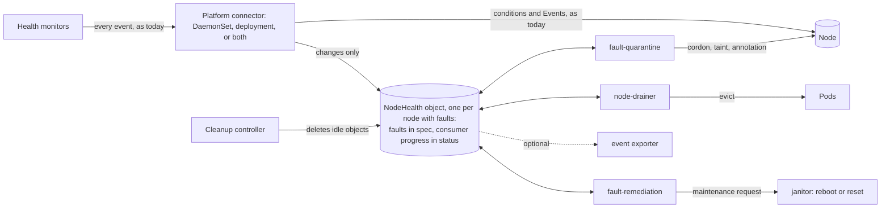
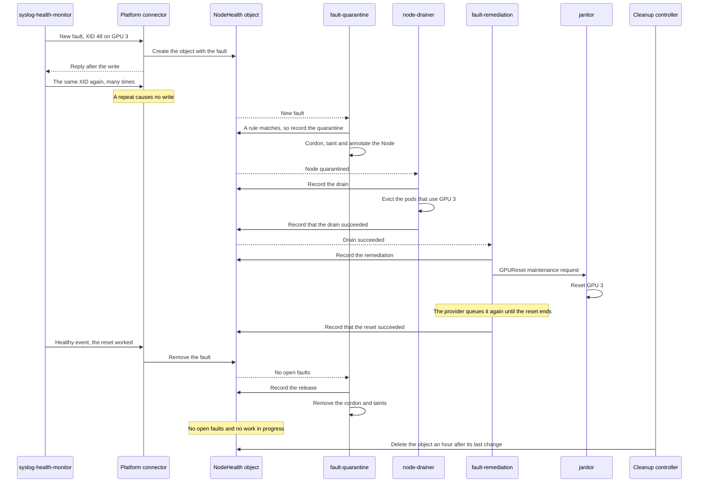

# ADR-066: Kubernetes-Native Remediation Without a Database

## Summary

- **Remediation without a database.** In Kubernetes mode, which `global.datastore.provider: kubernetes` selects, fault-quarantine, node-drainer and fault-remediation read one small `NodeHealth` object per node with faults, instead of MongoDB or PostgreSQL. The default does not change. The mode is meant for small clusters and for environments with no storage or managed database. Large clusters keep a database.
- **Only open faults, written only when they change.** A NodeHealth object keeps the faults that are open now, not a history of events, and each consumer records its progress in its own section. Monitors keep sending every event, but the platform connector writes only changes. A repeat causes no write, except the first one after a remediation attempt or after a quarantine ends. So a GPU that logs an XID (a GPU driver error) 600 times a second causes as few writes as one that logs it once, and a write limit for each node bounds the rest.
- **One store-client provider for either connector.** All code for the NodeHealth objects is in a new `kubernetes` provider of store-client, which each module runs in its own process. It builds today's events from the open faults, so the consumers keep their decision code. The connector keeps nothing in memory that it needs after a restart, so the DaemonSet connector and the deployment platform connector of [ADR-052](052-deployment-platform-connector.md) run the same code.
- **A node is released only on evidence.** Before fault-quarantine removes a node's cordon and taints, a newer write must show that the fault cleared. Missing data never releases a node.
- **What we give up.** Rules can no longer match a few rarely used event details, such as the event message ([list](#changes-for-rules)). The health-events-analyzer is not supported, and the event exporter and csp-health-monitor need changes. In the worst case, one 16 GB etcd that also holds the Node objects fits more than 16,000 nodes (estimate), or more than 34,000 if the circuit breaker caps quarantined nodes at 10% of GPU nodes ([details](#scale-and-etcd-usage)).

Numbers marked "(estimate)" are calculated from the design's limits and caps, not measured. A scale test will measure them. All limits and times in this design are fixed, unless the text calls them configurable.

## Context

### How remediation works today

Health monitors send their events to the platform connector. It runs in two roles, as a DaemonSet pod on each node and as the deployment platform connector of ADR-052, and an install uses one or both. In each role it stores each event in MongoDB or PostgreSQL. Three consumers react to each new event in the database: fault-quarantine cordons and taints faulty nodes, node-drainer evicts workloads, and fault-remediation creates a maintenance request, such as a RebootNode or GPUReset object, that janitor carries out. So remediation needs a database.

### Motivation

[Issue #1950](https://github.com/NVIDIA/NVSentinel/issues/1950) names three problems:

1. **Integration cost.** Many new clouds have no managed database, so operators export health events and build their own remediation.
2. **Deployment friction.** A plain Helm install cannot remediate, because the user must also run a second stateful system.
3. **Lost events.** The consumers act on each event once, so a lost event is a fault that is never remediated. Consumers lost events after a requeue and a restart ([#798](https://github.com/NVIDIA/NVSentinel/issues/798)).

NVSentinel's own telemetry shows that floods of XIDs also lose events. On four flooding nodes of one production cluster, the connectors restarted 125 times in one day, and fault-quarantine received only 53% of the events that the connectors received.

### Lessons from other projects

Other projects that kept a lot of state in custom resources hit etcd and API server limits. This design avoids each of their mistakes:

| Project | What went wrong | What this design does instead |
|---|---|---|
| Kyverno | It created report objects at the rate of events. 1.6 million objects (9.4 GB) made etcd read-only ([kyverno#8974](https://github.com/kyverno/kyverno/issues/8974)) | The number of NodeHealth objects can never exceed the number of Nodes, and the connector has a write limit for each node |
| Crossplane | Hundreds of CRDs overloaded API servers ([crossplane#2649](https://github.com/crossplane/crossplane/issues/2649)). Two controllers that fought over one field raised API server load fourfold ([crossplane#5458](https://github.com/crossplane/crossplane/issues/5458)) | Two new CRDs, and one writer for each section of a NodeHealth object |
| Dex | It created more than 500,000 objects in under 24 hours, and its cleanup, which listed them all, timed out ([dex#1292](https://github.com/dexidp/dex/issues/1292)) | Each idle object is deleted by name, without listing |
| Rancher Fleet | A status list with an entry for every resource on about 70 clusters went over etcd's request size limit ([fleet#3482](https://github.com/rancher/fleet/issues/3482)). An empty cache read as "not found" and uninstalled workloads ([fleet#5406](https://github.com/rancher/fleet/issues/5406), fixed in [fleet#5585](https://github.com/rancher/fleet/pull/5585)) | No list of nodes inside one shared object. An empty or unsynced cache never releases a node |

The Kubernetes documentation describes the best fit for custom resources as a relatively small number of relatively small objects that change relatively infrequently ([Declarative APIs](https://kubernetes.io/docs/concepts/extend-kubernetes/api-extension/custom-resources/#declarative-apis)). So this design stores one small object per node with faults, writes it only when something changes, and never stores one object per health event.

## Decision

We add **Kubernetes** as a third datastore option, next to MongoDB and PostgreSQL. It is selected with `global.datastore.provider: kubernetes`, and the default does not change. In this mode:

1. Each node that has faults gets one cluster-scoped `NodeHealth` object.
2. Monitors keep sending every event, as today. The platform connector, in either role, compares each event with the node's open faults, and it writes new faults, changed faults and clears before it replies to the monitor. A clear is a healthy event that removes a fault. A repeat of an open fault causes no write, except the first repeat after a remediation attempt that covers the fault, or after the node's quarantine ends, for example when someone else uncordons or untaints the node.
3. The three consumers, fault-quarantine, node-drainer and fault-remediation, read the NodeHealth objects instead of the database. The provider builds today's events from the open faults, so their decision code does not change. Before every cordon, eviction, reboot or reset, they read the current state again. A node is released only when a newer write shows that its faults cleared.
4. No database runs. The health-events-analyzer, which needs past events, is not supported. The event exporter reads the NodeHealth objects instead of the database, and csp-health-monitor keeps its maintenance events in a new custom resource.
5. All code that reads or writes NodeHealth objects is in the `kubernetes` provider of store-client, next to the MongoDB and PostgreSQL providers. Each module runs it in its own process, so no new component stands between the modules and the API server ([why not a proxy](#a-store-proxy-deployment)). The provider does not implement the store-client interface for health events, which assumes one stored document per event ([why](#a-kubernetes-provider-that-acts-like-a-database-of-events)). The consumers call the provider's own methods instead.

Kubernetes mode is for small clusters, where running a database costs more than it gives, and for environments with no storage or managed database service. We do not recommend it for large clusters. There, a separate database can grow without loading the API server and etcd that the rest of the cluster needs ([Scale and etcd usage](#scale-and-etcd-usage)).



The modules still do not call each other. They meet only in the NodeHealth object, the Node and the maintenance requests.

## Implementation

### The NodeHealth object

A NodeHealth object is named after its Node and owned by it, so there is at most one per live Node, and deleting the Node deletes it. A small cleanup controller deletes an object an hour after its last change, when no fault is open ([Deleting idle objects](#deleting-idle-objects)).

The owner reference names the UID of the Node. If a Node is deleted and a new Node with the same name appears before the garbage collector removes the old object, the old object names the old UID. The connector and the consumers compare the owner reference with the UID of the Node, and they treat the old object as missing. The connector rejects events for the node with the gRPC code `UNAVAILABLE`, so the monitor sends them again, until the garbage collector deletes the old object, which it does within seconds because its owner no longer exists. The next event then creates a new one.

Each object has two kinds of sections:

- **Open faults in `spec`, written by the connector.** `spec.checks` has one entry for each check of a monitor that has open faults, with those faults. Faults from monitors on the node and from cross-node monitors, which send events about other nodes, such as csp-health-monitor or lifecycle-manager ([ADR-051](051-maintenance-request.md)), are kept the same way. The connector knows which callers run on the node from the node binding of [ADR-052](052-deployment-platform-connector.md#authentication) ([Who writes each section](#who-writes-each-section)).
- **Consumer sections in `status`.** Each of the three consumers writes only its own section, to record what it did.

An object with one fault is about 1.6 KB. It holds at most 16 faults, and each fault at most 8 entities. When the object is full, the connector rejects a new fault as unavailable until a fault clears, and a metric counts it. Each shipped monitor sends it again, so the fault is late, not lost. The faults already in the object keep the node quarantined meanwhile.

The object stores nothing that can be derived from other data: no summary of the faults, no history of remediations and no count of repeats. These fields need explanation:

| Field | Meaning |
|---|---|
| `checks` | One entry for each check of a monitor that has open faults. `agent`, `check`, `componentClass` and `version` are stored once for all faults of the check. All four are part of what makes two faults the same, so none of them can be dropped |
| `faults` | One entry for each error code of an event, with the event's identifying entities, which usually name one device. A fault with no entities covers the whole node, and only a healthy event with no entities clears it |
| `entities` | Only identifying entities, such as `GPU_UUID` or `PCI`. The connector drops a fixed list of detail entity types, such as XID 74's register values `REG0` to `REG6` and XID 13's `GPC`, `TPC` and `SM`, and keeps every other type. So an event that differs only in detail entities is a repeat. If more than 8 entities are left, the connector keeps the first 8 |
| `reportedAt` | When the connector first wrote the fault or last changed it, or wrote the last event of it that a consumer waits for ([How the connector writes events](#how-the-connector-writes-events)). It becomes the time and part of the ID of the event that the consumers get. So a fault that survives a remediation, or that changes, reaches fault-remediation as a newer event, and fault-remediation acts on it |
| `writes` | The node's [write limit](#the-write-limit). `left` is how many writes the connector may still make for the node, and `refilledAt` is when writes last came back |
| `faultQuarantine.endedAt` | When the node's last quarantine ended, by a release, or by an uncordon or untaint from someone else. Drain and remediation records that started before it no longer count, and faults reported before it count again only when they are reported again |
| `faultRemediation.remediations` | One entry for each remediation target: when it started, the node's boot ID at the start, and its state. The attempt count stays in fault-remediation's Node annotation, as today |
| `scope` and `target` | The device of a drain or a remediation, written as `TYPE=value`, or `Node` for the whole node |
| `state` of a drain or remediation | `Running`, `Succeeded` or `Failed`. A deleted maintenance request counts as `Failed`. An attempt has finished when it is no longer `Running` |

**Example.** Node `gpu-node-17` has four open faults, three of them from syslog-health-monitor:

1. GPU 3 logged XID 48, a fatal memory error that calls for a GPU reset. The node is quarantined, the pods that use GPU 3 are evicted, and the GPU reset is running.
2. GPU 5 logged XID 48 too. That is a second fault in the same check entry.
3. GPU 6 fell off the bus. That is another check of syslog-health-monitor, so it has its own entry with the same `agent`.
4. The cross-node monitor lifecycle-manager reported planned host maintenance for the node, from a MaintenanceRequest that asks for an external repair ([ADR-051](051-maintenance-request.md)).

Faults 2 to 4 arrived in the last few seconds, and fault-quarantine has not handled them yet. The consumers get four events, one for each fault. The example leaves out fields that exist only when an event sets them, such as override flags. It assumes that partial drains and GPU resets are turned on. Both are off by default.

```yaml
apiVersion: healthevents.dgxc.nvidia.com/v1alpha1
kind: NodeHealth
metadata:
  name: gpu-node-17
  ownerReferences:
  - {apiVersion: v1, kind: Node, name: gpu-node-17, uid: 78ff5c0a-e565-4211-8378-6ddb47ee2a6b}
spec:
  writes: {left: 13, refilledAt: "2026-09-16T12:43:58.511870Z"}   # the write limit, after 4 writes
  checks:
  - agent: syslog-health-monitor              # entry 1: the XID check of syslog-health-monitor
    check: SysLogsXIDError
    componentClass: GPU
    version: 1
    faults:                                   # one fault for each error code of an event
    - errorCode: "48"                         # fault 1: XID 48 on GPU 3
      isFatal: true                           # stays true while the fault is open
      recommendedAction: COMPONENT_RESET      # the latest action
      entities:
      - {type: GPU_UUID, value: GPU-67fec4a7-a3e1-385c-0c98-4361b4a372ca}
      - {type: PCI, value: "0002:00:03"}
      reportedAt: "2026-09-16T12:39:26.104512Z"
    - errorCode: "48"                         # fault 2: the same XID on GPU 5 is its own fault
      isFatal: true
      recommendedAction: COMPONENT_RESET
      entities:
      - {type: GPU_UUID, value: GPU-1b9d4e20-77c3-4f0a-9e65-2c8a0d5b13f7}
      - {type: PCI, value: "0002:00:05"}
      reportedAt: "2026-09-16T12:43:58.511870Z"
  - agent: syslog-health-monitor              # entry 2: the same monitor, another check
    check: SysLogsGPUFallenOff
    componentClass: GPU
    version: 1
    faults:
    - errorCode: GPU_FALLEN_OFF_BUS           # fault 3: GPU 6 fell off the bus
      isFatal: true
      recommendedAction: RESTART_BM
      entities:
      - {type: PCI, value: "0002:00:06"}
      reportedAt: "2026-09-16T12:43:59.002914Z"
  - agent: lifecycle-manager                  # entry 3: a cross-node monitor
    check: csp-scheduled-maintenance
    componentClass: Node
    version: 1
    faults:
    - isFatal: false                          # fault 4: the whole node; not fatal, as MaintenanceRequests usually are
      recommendedAction: CUSTOM
      customRecommendedAction: external-remediation
      attributes: {maintenanceRequestName: mr-gpu-node-17-7f3a}   # allow-listed metadata only
      reportedAt: "2026-09-16T12:44:00.412306Z"
status:
  faultQuarantine:
    state: Quarantined                        # Quarantined, WouldQuarantine (dry run), Released or Cancelled
                                              # no endedAt: this is the node's first quarantine
  nodeDrainer:
    drains:                                   # one entry per drain scope: one device, or Node
    - {scope: GPU_UUID=GPU-67fec4a7-a3e1-385c-0c98-4361b4a372ca, state: Succeeded, startedAt: "2026-09-16T12:40:01.220931Z"}
  faultRemediation:
    remediations:                             # the attempt count stays in fault-remediation's Node annotation
    - {target: GPU_UUID=GPU-67fec4a7-a3e1-385c-0c98-4361b4a372ca, state: Running, startedAt: "2026-09-16T12:41:10.031877Z", bootID: 4f2c9a10-3e71-4a55-9c3e-8d1b2f7a6e04}
```

Each new fault was one write. Fault 1 left 15 writes, and one write came back 4 minutes later, so all 16 were back when fault 2 arrived. Faults 2 to 4 left 13.

### Who writes each section

- **Who writes what.** The connector writes `spec`, and the consumers write `status`. Role-based access control (RBAC) enforces this split. Inside `status`, each consumer patches only its own section.
- **Node binding.** ADR-052's node binding ties each monitor's token to its node, so a monitor that runs on a node can report only about that node. Node binding does not limit the connector itself, and RBAC cannot limit a DaemonSet connector pod to the object of its own node. So a compromised node could write the `spec` of any NodeHealth object, for example a clear that releases another node. Today every connector pod already holds a database credential that can write events for any node, so this is no wider than database mode.
- **Admission policy.** On Kubernetes 1.30 or later, the chart adds a ValidatingAdmissionPolicy that lets a DaemonSet connector pod change only the object of its own node, named in its service account token. It adds the policy only when every cross-node monitor that it installs publishes through the deployment platform connector (`publishTo: deployment`) and `global.platformConnectorAuth.crossNodeServiceAccounts` is empty, because otherwise DaemonSet pods may carry cross-node events.
- **Callers on the node.** The connector treats a caller as running on the node only when node binding limits the caller to that node and every event of its batch names that node. A caller on the cross-node allowlist of ADR-052, such as kubernetes-object-monitor, never counts as running on the node, even when its pod runs there. Neither does a caller that node binding could not verify. Callers on the DaemonSet socket that send no token count as running on the node. The connector needs node binding to tell these callers apart, so in Kubernetes mode it refuses to start while `global.platformConnectorAuth.enabled` is `false`. Audit mode is enough, because the connector needs only to know where a caller runs.
- **Conditional writes.** Every write, and the delete of an idle object, fails if the object changed after the writer read it. Kubernetes does this with `metadata.resourceVersion`, so no writer overwrites or deletes a change that it has not seen. Each writer patches only its own section, so a writer from an older release never changes another writer's section. After a failed write, the connector reads the object again and handles the event once more. If it still cannot write, it rejects the event as unavailable. A consumer whose write fails is queued again with a backoff.
- **Ordered times.** Every fault, drain, remediation and quarantine time that a writer stores is later than every such time already in the object, with microsecond precision. A writer uses its own clock, or one microsecond after the latest stored time when its clock is behind. So these times are in the order of the writes, whatever the clocks of the hosts say, and the rules below can compare them. `writes.refilledAt` is not part of this order, because it moves on in steps of 4 minutes.

### How the consumers get today's events

The consumers keep the code that decides what to do with an event: fault-quarantine's rules, node-drainer's drain choices, and fault-remediation's actions and request templates. The store-client provider builds today's `HealthEvent` from each open fault, and the consumers pass it to that code:

| `HealthEvent` field | Taken from |
|---|---|
| `nodeName` | The object's name |
| `agent`, `checkName`, `componentClass`, `version` | The fault's entry in `checks` |
| `isFatal`, `recommendedAction`, `customRecommendedAction`, `quarantineOverrides`, `drainOverrides` | The fault |
| `errorCode` | The fault's error code |
| `message` | Empty, because the object keeps no message (see below) |
| `entitiesImpacted` | The fault's entities |
| `metadata` | The fault's attributes: the event's metadata keys that are on a fixed allow-list, `creator_id` and `maintenanceRequestName` |
| `generatedTimestamp`, and the stored event's creation time | `reportedAt` |
| `isHealthy` | False for each open fault. For each fault that cleared, fault-quarantine also gets one healthy event ([how](#clearing-faults)) |
| `processingStrategy` | Always `EXECUTE_REMEDIATION`, because [other events never change the object](#how-the-connector-writes-events) |
| `id` | Built from the object's UID, the check, the error code, the entities and `reportedAt`, so it stays the same after a restart. It starts with the UID, so fault-quarantine's annotation shows which object each fault came from. It changes when `reportedAt` changes, but fault-quarantine's Node annotation keeps the event that it first recorded, so the consumers match a fault in the annotation by its check entry, error code and entities |

**No event message.** The object keeps no event message, because repeats are not written, so a stored message would describe only the first event of a fault. The `HealthEvent` that the consumers get therefore has an empty `message`. The `cordon-reason` Node label of a forced quarantine gets the check name instead, and the allow-list keeps `creator_id`, because the `cordon-by` label of a forced quarantine reads it. Templates that read `.HealthEvent.Message` get an empty string, so a custom drain, a maintenance request or an ExternalRemediationRequest ([ADR-040](040-external-remediation-request.md)) made from one has no message. The `quarantineHealthEvent` Node annotation and the changes that the event exporter sends have no message either. Operators still see the messages in Node conditions and Events, as today.

**The provider's queues.** The decision code stays, but the code around it changes:

- The provider watches the NodeHealth objects with an informer instead of a database change stream. Each cache keeps only the fields that its consumer uses.
- For each consumer, it keeps a queue that holds each node at most once, so the queue never grows beyond the number of nodes. When a node leaves the queue, it builds the node's events from the current object. The events of open faults come before any healthy event, so a new fault holds the node before a clear can release it.
- It queues the node again with a backoff when the consumer fails, and after a delay while a drain or maintenance request that the consumer started still runs, as the consumers requeue today. An update that arrives during a pass also queues the node again, so the consumer handles it once more, as with the client-go work queue.
- Each pass acts only on work that the consumer's own section does not record yet, so a repeated pass changes nothing. A consumer's own status writes do not queue it again. The provider queues each consumer only for the changes that it needs:

| Consumer | Queued when this changes |
|---|---|
| fault-quarantine | `spec`, which raises `metadata.generation` |
| node-drainer | `spec`, fault-quarantine's section, or fault-quarantine's annotation on the Node, because node-drainer drains the devices listed there |
| fault-remediation | `spec`, or the sections of fault-quarantine and node-drainer |

When a quarantine ends, the provider gives node-drainer and fault-remediation one event that says so, as they get today. After a restart, it gives this event again for each object whose quarantine has ended. On this event, both stop unfinished work, remove their records from `status`, and clear their own state, such as fault-remediation's Node annotation.

Each consumer acts on the faults in `spec` and on live state: the Node, its pods and the maintenance requests. It records what it did in its own section of `status`, and the next consumer reads that section to pick up the work, as the Deployment controller reads ReplicaSet status. As today, fault-quarantine also lists the faults that hold the node in its `quarantineHealthEvent` Node annotation, which it writes with the cordon, and the other two consumers read them there. After a restart the consumers read the current objects instead of replaying events.

### Changes in each component

| Component | Change for Kubernetes mode |
|---|---|
| Health monitors | They keep sending every event in today's format. Their publishers add the node's boot ID to each event's metadata. The preflight checks and custom monitors may leave it out ([how](#how-the-connector-writes-events)) |
| csp-health-monitor | Keeps its maintenance events in a new `CSPMaintenanceEvent` custom resource instead of the database, through a Kubernetes implementation of its own store |
| store-client | Adds the `kubernetes` provider. It holds all code that reads or writes NodeHealth objects, such as the connector's writer and the consumers' informers, queues and event rebuild |
| Platform connector, both roles | The provider's writer replaces the database writer. It writes only changes, and in both roles it replies to the monitor only after the write ([How the connector writes events](#how-the-connector-writes-events)). Node conditions and Events stay as today, because other tools read them |
| fault-quarantine | Gets today's events from the provider instead of the database, for its existing rules, and a healthy event for each fault that cleared. It records each quarantine in its own section, and `endedAt` when the quarantine ends |
| node-drainer | Drains for the devices in fault-quarantine's Node annotation, using the action of each matching fault, and records each drain in its own section. A provider helper tells it whether a scope is already drained in this quarantine, and it times each drain from its own record. Its work is keyed by node instead of the event priority queue of [ADR-041](041-node-drainer-priority-queue.md). A node whose drain still runs waits outside the queue until its delay ends, so new nodes do not wait behind it, as with ADR-041's order |
| fault-remediation | Starts a remediation only after a drain that covers its target succeeded, and records each maintenance request and its state in its own section. It uses its record's `startedAt` as the time of the attempt. Because the provider gives it the same events again, it retries only for a newer event of the fault, also after a failed or deleted request |
| janitor | No change. It still carries out the maintenance requests |
| Cleanup controller | A new, small Deployment with one replica that deletes idle NodeHealth objects ([Deleting idle objects](#deleting-idle-objects)). It has its own small image, built with ko like the other Go images. Its code is in the store-client provider |
| Event exporter | Watches the NodeHealth objects through the provider and sends each change, instead of reading the database |
| health-events-analyzer | Not supported in this mode |
| Helm chart | Adds `kubernetes` as a value of `global.datastore.provider`, the keys `global.datastore.kubernetes.recordNonFatal` (default `false`) and `global.datastore.kubernetes.copyIdleTime` (default 10 minutes), the cleanup controller, the ValidatingAdmissionPolicy of [Who writes each section](#who-writes-each-section) and RBAC. The NodeHealth and CSPMaintenanceEvent CRDs go in the existing `k8sdatastore-crds` chart, which `global.k8sdatastoreCrds.enabled` installs, next to its HealthEventResource CRD of ADR-027. In Kubernetes mode the chart runs no database and does not install the analyzer, even when `global.healthEventsAnalyzer.enabled` is `true` |
| Helm checks | The chart refuses Kubernetes mode while `global.k8sdatastoreCrds.enabled` or `global.platformConnectorAuth.enabled` is `false`, or while `global.mongodbStore.enabled` or `postgresql.enabled` is `true`. These two flags install a database, and the MongoDB flag also turns on the connector's MongoDB writer. Until the event exporter and csp-health-monitor support Kubernetes mode, the chart also refuses to install them in it |

### Example: one GPU fault from detection to recovery

GPU 3 on node `gpu-node-17` logs XID 48, a memory error that calls for a GPU reset.



### How the connector writes events

The connector keeps a copy of the object of each node that it gets events for:

- It reads the object by name when an event for the node arrives and it holds no copy. With each read, and before it creates an object, it also reads the Node by name, for the UID that it puts in the owner reference of a new object and compares with the owner reference of an existing one.
- If the Node does not exist, the connector accepts the event and writes nothing. If the node has no object, it remembers that like a copy, so a healthy event for a node without faults causes no write.
- Its own writes keep the copy current. It reads the object again at the first event for that node after a monitor connects, because earlier events may have gone through another connector. It also reads it again when a repeat finds the copy more than a minute old, so it sees the consumers' records without one read per event.
- It drops a copy when no event for that node arrived for a configurable time, `global.datastore.kubernetes.copyIdleTime`, 10 minutes by default. So it holds copies only for nodes whose monitors send events, and a DaemonSet connector pod that carries no cross-node events holds at most the copy of its own node.
- These reads do not come from a cache, because a cache can miss a clear that another connector wrote. The connector never lists or watches NodeHealth objects or Nodes. If a read fails, it rejects the event as unavailable.
- The copy only saves reads: every write is conditional, so a write from a stale copy fails, and the connector reads the object again.

For each event, the connector looks for a matching open fault in its copy. It uses the matching code of fault-quarantine, which moves into the provider, so the connector and fault-quarantine agree on what counts as the same fault. Then:

- **A new or changed fault** is written to the object with a new `reportedAt` before the connector replies to the monitor. A fault changes when it becomes fatal, or when its action, override flags or attributes change.
- **A repeat of an open fault** causes no write. The one exception is an event that a consumer waits for, which the connector writes once with a new `reportedAt`:
  - **After a remediation attempt.** The first event of the fault after fault-remediation's newest attempt that covers it finished, or in a new boot of the node. An attempt covers a fault when it acts on the fault's device or on the whole node, so a reboot covers a GPU fault. Only events from monitors that run on the node count, because a cross-node monitor can send a maintenance fault again after the reboot, and that does not mean the reboot failed. So fault-remediation retries or escalates for faults from monitors on the node, as today, and never reboots twice for one maintenance. It does not retry a fault from a cross-node monitor, which keeps the node quarantined until it clears.
  - **After a quarantine ends.** The first event of the fault after fault-quarantine recorded `endedAt`. So when someone else uncordons or untaints the node, fault-quarantine quarantines the node again, as today.

The connector writes such an event only if the fault's `reportedAt` is earlier than the `startedAt` of the newest attempt that covers it, or earlier than fault-quarantine's `endedAt`, whatever fault-quarantine's state is now. Stored times are ordered, so the new `reportedAt` is later than both, and each such event is written once.

For example, a GPU that floods XID 137 and 145 at 120 to 600 events per second costs its node at most 2 writes when the flood starts, and none after that until a remediation attempt or the end of a quarantine. Those 2 writes keep at most about 4.3 KB of etcd history (estimate).

**How the connector detects a reboot.** Database mode stores every event, but here a repeat causes no write, so the connector must know whether a repeat comes from a new boot:

1. The shared publisher of the Go monitors and the publisher of gpu-health-monitor read the node's boot ID from `/proc/sys/kernel/random/boot_id` when they start. They add it to each event in the `bootID` key of its `metadata`, as the connector does with its `idempotencyKey`, so the `HealthEvent` schema does not change. The object does not store the boot ID.
2. When fault-remediation starts an attempt, it records the node's boot ID (`status.nodeInfo.bootID`, the same value) in its record.
3. If a repeat from a monitor on the node carries a different boot ID, it is the first event after the reboot.

An event from an older boot cannot arrive later, because the monitors on the node, and any events they have not sent yet, stop when the node reboots, and the connector holds no events. So the connector does not read the Node to detect a reboot, and it does not depend on when the kubelet publishes the new boot ID. A finished attempt alone is not enough, because after a reboot gpu-health-monitor sends a fault that is still there once, often before fault-remediation records that the attempt finished. An event without a boot ID, from an older or a custom monitor, counts only after a finished attempt. If such a monitor sends a fault only once after a reboot, fault-remediation does not retry, and the node stays quarantined until an operator acts.

**Which events the writer uses.**

- The writer handles each event after the connector's metadata and override stages and before the optional deduplication stage of [ADR-039](039-health-event-deduplication.md), which is off by default. Today the database writer gets the batch only after every stage. That stage never drops an event: it only marks a repeated syslog XID or SXID event `STORE_AND_ANALYSE`, so that the Node conditions ignore it. Because the NodeHealth writer reads each event before any duplicate mark, a stale mark cannot hide a fault that came back, for example when a replica of the deployment platform connector missed the clear.
- Like fault-quarantine today, the writer uses only `EXECUTE_REMEDIATION` events, healthy or unhealthy. `STORE_ONLY` and `STORE_AND_ANALYSE` mean that an event must not change the cluster, so such an event never opens or clears a fault, or uses the node's write limit.
- The writer skips unhealthy events that are not fatal from monitors on the node, because no shipped ruleset quarantines on them, unless `global.datastore.kubernetes.recordNonFatal` is `true`. It keeps them from cross-node monitors: a MaintenanceRequest ([ADR-051](051-maintenance-request.md)) is usually not fatal, and the shipped ruleset for it does not check `isFatal`.

### The write limit

Each node has a write limit of 16 writes, and one write comes back every 4 minutes. The limit counts writes, not bytes, because the caps on faults and entities already bound the size of each write. The object keeps the limit in `writes`, so every connector replica sees the same limit, also after a restart:

- `left` is how many writes the connector may still make for the node. Each event that the connector writes uses one, also when one batch has several such events. The consumers' writes to `status` do not count.
- `refilledAt` is when writes last came back. Before each write, the connector adds one write for each full 4 minutes since `refilledAt`, up to 16, and moves `refilledAt` on by the same number of 4-minute steps. When all 16 are back, it sets `refilledAt` to now.

A clear from a monitor on the node may not use the last 8 writes. So these 8 writes stay for new and changed faults, and for the events that a consumer waits for, which may use all 16. Cross-node monitors send few clears, and some send a clear only once, so their clears may use all 16 writes.

When an event cannot be written because its node has no write left for it, the connector rejects the event as unavailable at once, and the monitor sends it again later. The connector still writes the other events of the batch, so they are repeats when the monitor sends the batch again.

### Clearing faults

A healthy event removes the matching faults from the object at once. It removes a fault only if fault-quarantine's matching code would clear every entity of that fault:

- A healthy event that names only some of the entities leaves the fault open, just as fault-quarantine keeps the node quarantined for it in database mode today.
- Two such healthy events that together name all the entities also leave it open, while database mode releases the node after both. The node then stays quarantined until one healthy event clears the fault.

In the example, a healthy event for XID 48 on GPU 5 removes only fault 2. After a reboot, syslog-health-monitor sends one healthy event for each check, which covers the whole check. The one for the XID check removes faults 1 and 2, and only the one for the GPU-fallen-off check removes fault 3.

For each fault that fault-quarantine tracks in its Node annotation and that a newer version of the same object no longer has, the provider gives fault-quarantine one healthy event with the fault's check, error code and entities. So fault-quarantine handles it as today, and it releases the node when the quarantine ends, which [ADR-062](062-fault-quarantine-release-at-session-end.md) calls the session end. The provider never gives a healthy event that would also clear a fault that is still open, for example one for a whole check while another fault of that check is open. After a restart, it does the same for each fault in the annotation that the object no longer has, but only if the object still has the UID that starts the fault's event ID. A missing or re-created object releases nothing.

As in database mode, a clear needs no delay, and a device that keeps failing and recovering releases and quarantines its node again on each cycle. Clears from monitors on the node cannot use the last 8 writes, so the [write limit](#the-write-limit) bounds these cycles. Handling such devices is out of scope for this ADR.

The connector applies each monitor's events in the order they arrive, not by their timestamps. After a reboot, syslog-health-monitor first sends a clear for each check and then reads the new boot's log from the start. So an XID that the GPU logged before the clear arrives after it, and it reopens the fault.

### Deleting idle objects

Kubernetes has no built-in expiry for custom resources, so a small cleanup controller deletes idle objects. It runs as its own Deployment with one replica whenever `global.datastore.provider` is `kubernetes`, so it also runs when fault-quarantine is not installed. It does not use janitor's TTL controllers of [ADR-037](037-janitor-cr-ttl-cleanup.md), because Kubernetes mode must not depend on janitor. Those controllers also delete an object at a fixed time after they first see it, write annotations to it, and delete it without a precondition. ADR-037 names a separate Deployment as the right place for kinds outside janitor.

The controller watches the NodeHealth objects with an informer, which lists them once when it starts, and it never lists them to find idle objects. It deletes an object when all of these hold:

- The object has no open faults.
- No consumer holds the node: fault-quarantine's state is not `Quarantined`, no drain or remediation record is `Running`, and the Node has no quarantine annotation of fault-quarantine and no remediation annotation of fault-remediation.
- The object has not changed for 60 minutes. The controller times this in memory, so a restart only delays a delete. By then at least 15 of the node's 16 writes are back, so a new object gives the node at most one extra write.

Before it deletes, the controller reads the object and the Node by name from the API server and checks these conditions again. The delete is conditional on the object's version, so it fails if a connector wrote a new fault in between. A connector whose copy is older than the delete gets "not found" on its next write. It then discards its copy and handles the event as for a node that has no object.

### Safety rules

- **Release only on evidence.** Before fault-quarantine releases a node, a newer write of the same object must no longer contain its faults. A missing, unsynced or re-created object releases nothing. A lost `status`, for example after a restore, releases nothing either, because the faults in `spec` still hold the node.
- **Re-check before acting.** Each consumer reads the object and the Node again from the API server, not from its cache, before it acts. A remediation starts only after a drain that covers its target succeeded: a drain of one GPU covers only a reset of that GPU, and a reboot needs a drain of the whole node. It starts only for a fault that is still open, and never while janitor still runs another maintenance request for the node. A remediation is never retried on a timer, only when the fault is reported again after the last attempt.
- **Circuit breaker.** The circuit breaker of [ADR-022](022-circuit-breaker-reset-mechanism.md) and its settings decide how many nodes fault-quarantine quarantines, as today. Kubernetes mode adds no cluster-wide limits of its own. The breaker's standing limit, `fault-quarantine.circuitBreaker.maxCordonedPercentage`, is off by default. Clusters close to the limits in [Scale and etcd usage](#scale-and-etcd-usage) should set it. A breaker reset cannot skip open faults: fault-quarantine evaluates every open fault, whichever cursor (`RESUME` or `CREATE`) the reset names.
- **Uncordons and untaints by someone else.** An operator or another controller can end a quarantine while a fault is open, by uncordoning the node or by removing a taint that fault-quarantine applied. In both cases, fault-quarantine records `Cancelled` and `endedAt` in its section before it removes its annotations from the Node, and it stops if that write fails. If the node has no NodeHealth object, there is nothing to record, and it goes on. As today, it leaves its taints and rule labels on the Node after an uncordon, and it detects both changes from its own annotations, so a crash before its cordon is not taken for an uncordon. The provider gives it only faults reported after `endedAt`, so it quarantines the node again only when the fault is reported again, also after a restart.
- **Records from an earlier quarantine.** A drain or remediation record counts only while fault-quarantine's state is `Quarantined` and the record started after `endedAt`. So after an uncordon, node-drainer drains again before fault-remediation acts, and pods that started on the node in between are evicted first.
- **Safe restarts.** Every step is safe to repeat, and each consumer records what it will do before it does it. A crash test restarts each component after each write and checks the result.
- **A full etcd.** When etcd is full, no new cordon, drain or maintenance request starts.

### Release at session end and post-remediation validation

Two fault-quarantine features decide when a node's cordon and taints come off. Both keep working in Kubernetes mode:

- **Release at session end ([ADR-062](062-fault-quarantine-release-at-session-end.md)).** When a fault opens, fault-quarantine applies the taints and the cordon that its rules require, also when the node is already quarantined. It removes them only when the session ends: every fault in the session has cleared.
- **Post-remediation validation ([ADR-049](049-node-validation.md)).** A NodeHealth object drops a fault once it clears, so fault-quarantine keeps recording which faults need validation in its Node annotation, as today. When the session ends, it checks the drain in `status.nodeDrainer` instead of the database, creates the `ValidationRequest`, and leaves the cordon and taints for lifecycle-manager, which removes them after validation passes, as today.

### Changes for rules

The event that fault-quarantine gives its rules has the same 18 fields as today ([How the consumers get today's events](#how-the-consumers-get-todays-events)), and all 8 shipped rulesets keep matching. The rulesets that the proposed [ADR-064](https://github.com/NVIDIA/NVSentinel/pull/2026) adds to node-drainer and fault-remediation read the same events. ADR-064's decisions on each event go into the consumer's own record: node-drainer's drain record keeps the ruleset and the method or a stop, and fault-remediation's record keeps the ruleset and the action or a stop. For ADR-064, the quarantine session is the current quarantine, which starts after `endedAt` if there is one. But rules can no longer select on:

- the event message, because the object keeps none,
- detail entities, such as XID 74's register values, because the object keeps only identifying entities,
- event metadata outside the allow-list,
- unhealthy events that are not fatal from monitors on the node, unless `global.datastore.kubernetes.recordNonFatal` is set to `true`,
- more than 8 entities per fault,
- a fault beyond the cap of 16, until another fault of the node clears,
- two error codes of one event together, because each code becomes its own fault. No shipped monitor or ruleset does this.

### Other components that use the database

Three components use the database today for more than remediation:

- **The health-events-analyzer is not supported.** It finds patterns over time, such as an XID that repeats many times in a day, and 15 of its 22 default rules need past events. A NodeHealth object keeps only the faults that are open now, so installs that need the analyzer stay in database mode.
- **The event exporter needs a change.** It reads new events from the database and sends them to an HTTP endpoint ([ADR-012](012-health-events-exporter.md)). In Kubernetes mode it watches the NodeHealth objects with its own watch, not the consumers' queue, which keeps only the latest state of a node. It sends each change, such as a new fault, a changed fault or a clear, not every repeated event and no `STORE_ONLY` or `STORE_AND_ANALYSE` events. Its delivery is weaker than in database mode, because the objects keep no history: after a restart or a lost watch, it sends the open faults again, and it cannot send a fault that opened and cleared while it was not watching.
- **The csp-health-monitor store moves to a custom resource.** It keeps each planned maintenance event in a new `CSPMaintenanceEvent` object instead of the database, with the same fields, through a Kubernetes implementation of its existing store interface. So neither its logic nor its maintenance-notifier sidecar changes. A ConfigMap keeps how far it has read each cloud provider's events, and csp-health-monitor deletes each object 7 days after its maintenance ended or its last update, whichever is later. So there are about as many objects as nodes with planned or recent maintenance.

### Scale and etcd usage

Kubernetes mode is for small clusters, so this section asks how many nodes fit on one etcd in the worst case. The etcd cost grows with the number of nodes and with how often faults change, not with how many events the monitors see. So even 10 to 100 times today's peak event rate does not change it.

The worst case counts the live object and every old version that etcd keeps for 10 to 15 minutes ([why](#a-counter-that-changes-on-every-repeat-the-issues-proposal)). It assumes that every node uses its full write limit, every cleared fault opens again, every consumer works at full speed, and every object is at the caps: 16 faults with 8 entities, which is about 8.6 KB, or 11.5 KB with the records of all three consumers. It also depends on the circuit breaker. With the breaker's defaults, which have no standing limit, every GPU node can end up quarantined and carry the consumers' records. With the standing limit set to 10% of GPU nodes (`fault-quarantine.circuitBreaker.maxCordonedPercentage: 10`), only one node in ten does.

| Worst case for each node (estimate) | Breaker defaults | 10% standing limit, average |
|---|---|---|
| Live object | 11.5 KB | 9 KB |
| Connector writes: 16 at once, then one for every 4 minutes of history | 212 to 227 KB | 164 to 175 KB |
| Consumer writes: 8 for one quarantine with one drain and one remediation (2 by fault-quarantine, and 3 each by node-drainer and fault-remediation), up to about 20 when the GPUs of a node are drained and reset one after another | 92 to 230 KB | 9 to 23 KB |
| Total | About 320 to 470 KB | About 180 to 210 KB |

Each row of the next table gives the largest cluster whose worst case fits in half of the etcd space that the Node objects leave, at about 55 KB for each Node ([#1705](https://github.com/NVIDIA/NVSentinel/issues/1705)). The other half stays free for the rest of the cluster. The ranges cover 10 and 15 minutes of etcd history and 8 to 20 consumer writes per node.

| etcd size | Largest cluster with the breaker's defaults (estimate) | Largest cluster with a 10% standing limit (estimate) |
|---|---|---|
| 2 GiB (self-managed) | About 2,200 to 3,100 nodes | About 4,600 to 5,100 nodes |
| 8 GB (EKS standard, AKS) | About 8,100 to 11,700 nodes | About 17,100 to 19,100 nodes |
| 16 GB (EKS Provisioned) | About 16,200 to 23,300 nodes | About 34,200 to 38,300 nodes |
| 20 GB (EKS ultra-scale, if Node objects are in another etcd partition) | About 21,400 to 31,700 nodes | About 48,400 to 55,100 nodes |

For example, 16,000 Node objects take about 0.9 GB of a 16 GB etcd. Half of the rest, about 7.5 GB, is for the NodeHealth objects, and their worst case is about 5 to 7.5 GB with the breaker's defaults, or about 2.9 to 3.3 GB with a 10% standing limit (estimate). A node with one open fault costs only about 3 KB.

If the only fault of a node keeps failing and recovering, the node can be quarantined up to 6 times in 10 to 15 minutes, because clears from the node may not use the last 8 writes. If every node did that, the 16 GB row would drop to about 10,000 nodes with the breaker's defaults and about 30,000 with a 10% standing limit (estimate). The table shows limits, not a recommendation: large clusters keep a database.

### Switching an existing install

A new install sets `global.datastore.provider` to `kubernetes`. Kubernetes mode has no data migration: an existing install that switches starts with no NodeHealth objects, and the new consumers do not take over work that started before the switch. So an existing install switches in three steps:

1. Wait until fault-quarantine has handled every open fault, no drain or maintenance request still runs, and the circuit breaker is not tripped.
2. Apply the chart's CRDs, because `helm upgrade` does not install them, and upgrade with `global.datastore.provider` set to `kubernetes`.
3. Check the nodes that are still quarantined, and remove their cordon and taints. They stay quarantined after the switch, because a missing object never releases a node.

A fault from before the switch counts only when its monitor sends it again, also a fault that an old connector pod wrote to the database during the upgrade. After the switch, csp-health-monitor sees only maintenance events from about the time of the switch. A switch back to a database needs an empty database, because the consumers would act on events left from before the switch.

## Rationale

- **Each node's open faults are stored, not every event.** The number of NodeHealth objects grows with the number of nodes that have faults, and the number of writes grows with how often faults change. This avoids the failures in [Lessons from other projects](#lessons-from-other-projects).
- **Faults go in `spec`, and consumer progress goes in `status`.** Creating an object with its faults in `spec` takes one write, and `status` would need a second. Consumer writes to `status` do not change `metadata.generation`, so a consumer can tell a fault change from another consumer's write. RBAC can then separate the connector from the consumers, which the Kubernetes proposal [KEP-2527](https://github.com/kubernetes/enhancements/tree/master/keps/sig-architecture/2527-clarify-status-observations-vs-rbac) names as the reason for the split. A restore that drops `status`, as [Velero](https://velero.io/docs/main/restore-reference/) does by default, cannot drop open faults. Lease, CSINode and ResourceSlice also keep what node agents report in `spec`.
- **Monitors keep their contract, and the connector drops repeats.** The connector already receives every event in both roles, so it is the right place to compare an event with the open faults and drop a repeat. Everything else lives in the NodeHealth object, so any connector replica can handle any event. Kubernetes treats repeated Events in a similar way: it keeps one Event instead of one object per repeat, and it limits how often a source writes ([kubernetes#47367](https://github.com/kubernetes/kubernetes/pull/47367)).
- **Releasing a node is the risky action, so it needs evidence.** A wrong release puts a faulty GPU back into service. Stale state was the largest class of the controller bugs that [Sieve](https://www.usenix.org/system/files/osdi22-sun.pdf) found (19 of 46). Releasing only on evidence, conditional writes and fresh reads before each action close those paths.
- **The existing decision code stays**, so the rules and their tests carry over.

## Consequences

### Positive

- Remediation works without MongoDB or PostgreSQL. A plain Helm install can remediate, and a database outage can no longer stop remediation.
- During XID floods, the connector writes only changes, instead of one database write per event.
- Monitors, including custom monitors, keep sending today's events. The only addition is a boot ID in the metadata, which the shared publishers set.
- The same design works with the DaemonSet connector, the deployment platform connector or both, so customers can turn the DaemonSet off.
- A connector crash can no longer lose a fault or a clear, because both roles write them before they reply. Today the DaemonSet connector replies before it writes.
- The consumers act on the faults that are open now. After a restart they read the current NodeHealth objects instead of replaying old events, so a missed event no longer means a missed fault.
- Operators can list the nodes that have faults, or had one in the last hour, with `kubectl get nh` and see their open faults with `kubectl describe nh`.

### Negative

- **Fewer event details.** Rules, templates and the event exporter get no event message and no metadata outside the allow-list, so some custom rulesets and templates may need changes.
- **No event history.** An object keeps only open faults, and the cleanup controller deletes it about an hour after the last fault clears. Investigations must rely on the exported changes or on logs, and the event exporter cannot send a fault that opened and cleared while it was down.
- **No health-events-analyzer.** Patterns over time are not detected, such as an XID that keeps coming back or a node that needs remediation again and again. Installs that need the analyzer stay in database mode.
- **Changes in other components.** The event exporter and csp-health-monitor need code changes before they can run in this mode.
- **Late events.** When a node has used its write limit, the connector rejects its events that need a write until writes come back, and a clear from a monitor on the node is rejected already when only 8 writes are left. A node with 16 open faults gets further faults rejected until one clears. Each shipped monitor sends a rejected event again on its next poll or reconcile, so a change is late, not lost, but a late clear keeps the node quarantined longer. A monitor sends one batch at a time, so its later events wait meanwhile, including a cross-node monitor's events about other nodes.
- **Circuit breaker resets.** A reset with the `CREATE` cursor of [ADR-022](022-circuit-breaker-reset-mechanism.md) no longer skips the faults that arrived while the breaker was tripped, because fault-quarantine evaluates every open fault. So such a reset can trip the breaker again at once.
- **Cluster size.** In the worst case, one 16 GB etcd holds about 16,000 nodes, or about 34,000 with a 10% standing limit (estimate). The memory use of the API server and the consumers is unknown until the scale test.
- **More load on the control plane.** The remediation load moves from the database to the API server and etcd, which a managed control plane may not let an operator scale. The consumers read the object and the Node again before they act, and the connector reads the Node with each read of an object, so they make more API calls than in database mode. With the default client limit of fault-quarantine and node-drainer, 5 requests a second, a fault on many nodes at once takes longer to handle.
- **No data migration** from or to a database ([Switching an existing install](#switching-an-existing-install)).
- **New public types.** The NodeHealth and CSPMaintenanceEvent types must stay backwards compatible.
- **Two kinds of provider.** The consumers must support both the database providers and the Kubernetes provider, because database mode stays.
- **An experimental path.** When the DaemonSet is off, every write goes through the deployment platform connector, which ADR-052 still marks experimental.

## Alternatives Considered

### A counter that changes on every repeat (the issue's proposal)

**Rejected** because the counter does not scale. A patch that changes one small field is small to send, but the API server still writes the whole object to etcd as a new version and sends it to every watcher. A counter in `status` costs the same, because the API server stores `spec` and `status` as one object. Each old version stays in etcd for up to 10 minutes, or 15 during an API server failover. So a node that repeats an error 600 times a second would cause 600 full writes a second, and the XID flood in [How the connector writes events](#how-the-connector-writes-events) would add up to 1.23 GB of etcd history every 10 minutes (estimate). No decision uses how often a fault repeated. This design keeps the issue's core idea: one object per node that holds current state.

### One object per health event (ADR-027)

**Rejected** because the number of objects follows the event rate, which is how Kyverno filled etcd. Even one object per open fault would mean up to 16 objects for each node instead of one.

### A Kubernetes provider that acts like a database of events

**Rejected.** The provider could implement the store-client interface for health events as it is, so the consumers would not change at all. But that interface assumes one stored document per event: each consumer updates the status of each event, scans events by status and time when it starts, and resumes change streams where it stopped. The provider would have to copy these queries, change streams and resume points, which would make it a small database on etcd, with more code and more etcd writes than this design. Any difference from MongoDB could repeat a drain or a reboot.

### A store proxy Deployment

**Rejected** for now. A Deployment could run the provider once for all three consumers, as a proxy does for a database. It would save no writes, which are what etcd pays for, and it would not make reads faster, because the API server already serves watches from memory and each consumer must re-check with the API server before it acts. But every install would need it, all remediation would stop while it is down, and it would need failover and a backwards-compatible API. The provider lets us add a proxy later without changing the consumers, if the scale test shows that their memory or watches cost too much.

### Deleting the object when its last fault clears

**Rejected** because the consumers still need their sections until the drain and remediation records end. A new object also starts with a full write limit, so a device that keeps failing and recovering would get a new write limit each time.

### A separate central datastore (SQLite, kine or an aggregated API)

**Rejected** for the first release, because each option adds another stateful system that can fail, which is what issue #1950 wants to remove. Each would keep the NodeHealth writes out of etcd and could keep a history of events, but:

- **SQLite** allows one writer at a time and needs a persistent volume ([SQLite](https://www.sqlite.org/whentouse.html)). So one pod serves it as a single point of failure, and other pods cannot watch it.
- **kine** serves the etcd API on top of a SQL database. High availability needs an external database such as PostgreSQL or MySQL ([kine](https://github.com/k3s-io/kine)), which is the database this ADR removes.
- **An aggregated API server**, such as the reports-server that Kyverno built after report objects filled etcd ([kyverno#8974](https://github.com/kyverno/kyverno/issues/8974)), still has no high availability ([reports-server#117](https://github.com/kyverno/reports-server/issues/117)), and its failures broke other parts of the cluster ([#260](https://github.com/kyverno/reports-server/issues/260), [#343](https://github.com/kyverno/reports-server/issues/343)). While it is down, API discovery for its group fails across the cluster.

A central store stays the fallback if the scale test shows that one etcd cannot hold the worst case.

### An event database on each node (for example SQLite on the host)

**Rejected.** Each node would keep its events in a database file on the host, such as SQLite, written by its DaemonSet connector. That would cost no etcd space, keep a full event history on each node, and keep an XID flood on its own node. But:

- **The consumers run centrally.** They would have to poll thousands of node databases, which have no watch or change stream, and every node would need an API that serves its database to them.
- **Quarantine limits are cluster-wide.** The circuit breaker of [ADR-022](022-circuit-breaker-reset-mechanism.md) limits quarantines across the cluster, so fault-quarantine cannot move to the nodes.
- **Cross-node events have no node to write to.** The deployment platform connector and the cross-node monitors run centrally and cannot write files on other nodes. So the design would need the DaemonSet, which [ADR-052](052-deployment-platform-connector.md) lets customers turn off.
- **The history fails with the node.** The consumers cannot read it from an unreachable node, and a VM replacement or a re-image deletes it.
- **Disk and upgrades on every node.** One GPU can log 600 XID events a second, so every node would need retention and disk limits, and a schema change would need a migration on every node.

### An OpenTelemetry backend as the datastore

**Rejected** because these backends have no watch and no in-place update, and an outage of the observability stack would stop remediation. Exporting events to such a backend for analysis stays possible.

### The NVIDIA maintenance operator for cordon and drain

**Not part of this ADR.** The [maintenance operator](https://github.com/Mellanox/maintenance-operator) coordinates node maintenance through `NodeMaintenance` objects. A requestor creates one for a node, the operator cordons and drains the node within cluster-wide limits (`maxUnavailable` and `maxParallelOperations`), and the requestor deletes the object to give the node back. The Network Operator already uses it for driver upgrades ([discussion #2087](https://github.com/NVIDIA/NVSentinel/discussions/2087)).

It does not store faults, so it cannot replace the database or the NodeHealth objects. At most it could take over the cordon and drain steps of fault-quarantine and node-drainer, in both modes, but today it covers less than those steps need:

- It cordons the node but sets no taints.
- Its drain selects pods by label or by the name of the resource they request, so it cannot evict only the pods of one GPU. It also has one drain mode for all selected pods, while node-drainer chooses a mode per pod ([ADR-055](055-pod-drain-policies.md), [ADR-063](063-pod-drain-policies-owner-kinds.md)) and supports custom drains.
- It removes a request that has been ready for longer than `maxNodeMaintenanceTimeSeconds`, one hour by default. That would give a node with an open fault back to workloads.

Sharing one coordinator with driver and network maintenance is still worth its own ADR. One limit would then cover all of them, and operators would no longer have to exclude nodes from NVSentinel during driver upgrades.

## References

- NVSentinel: [issue #1950](https://github.com/NVIDIA/NVSentinel/issues/1950); [ADR-027](027-kubernetes-data-store.md) (superseded by this ADR) and its series [#640](https://github.com/NVIDIA/NVSentinel/pull/640), [#787](https://github.com/NVIDIA/NVSentinel/pull/787), [#882](https://github.com/NVIDIA/NVSentinel/pull/882), [#970](https://github.com/NVIDIA/NVSentinel/pull/970); issues [#798](https://github.com/NVIDIA/NVSentinel/issues/798), [#1705](https://github.com/NVIDIA/NVSentinel/issues/1705); [discussion #2087](https://github.com/NVIDIA/NVSentinel/discussions/2087); the `HealthEvent` prototype [#795](https://github.com/NVIDIA/NVSentinel/pull/795)
- Related records: [ADR-012](012-health-events-exporter.md), [ADR-022](022-circuit-breaker-reset-mechanism.md), [ADR-037](037-janitor-cr-ttl-cleanup.md), [ADR-039](039-health-event-deduplication.md), [ADR-040](040-external-remediation-request.md), [ADR-041](041-node-drainer-priority-queue.md), [ADR-049](049-node-validation.md), [ADR-051](051-maintenance-request.md), [ADR-052](052-deployment-platform-connector.md), [ADR-055](055-pod-drain-policies.md), [ADR-062](062-fault-quarantine-release-at-session-end.md), [ADR-063](063-pod-drain-policies-owner-kinds.md)
- Kubernetes: [custom resources](https://kubernetes.io/docs/concepts/extend-kubernetes/api-extension/custom-resources/); [KEP-2527](https://github.com/kubernetes/enhancements/tree/master/keps/sig-architecture/2527-clarify-status-observations-vs-rbac); [event spam filter #47367](https://github.com/kubernetes/kubernetes/pull/47367); stalled node-health proposals [KEP-4212](https://github.com/kubernetes/enhancements/issues/4212), [KEP-5233](https://github.com/kubernetes/enhancements/issues/5233), [KEP-5283](https://github.com/kubernetes/enhancements/issues/5283), [KEP-5770](https://github.com/kubernetes/enhancements/issues/5770)
- Lessons from other projects: [Kyverno #8974](https://github.com/kyverno/kyverno/issues/8974) and [reports-server](https://github.com/kyverno/reports-server); [Crossplane #2649](https://github.com/crossplane/crossplane/issues/2649) and [#5458](https://github.com/crossplane/crossplane/issues/5458); [Dex #1292](https://github.com/dexidp/dex/issues/1292); [Rancher Fleet #3482](https://github.com/rancher/fleet/issues/3482), [#5406](https://github.com/rancher/fleet/issues/5406) and [#5585](https://github.com/rancher/fleet/pull/5585); [Sieve](https://www.usenix.org/system/files/osdi22-sun.pdf); [Velero restore reference](https://velero.io/docs/main/restore-reference/)
- Maintenance coordination: [NVIDIA maintenance operator](https://github.com/Mellanox/maintenance-operator)
- Storage and scale: [EKS Provisioned Control Plane](https://docs.aws.amazon.com/eks/latest/userguide/eks-provisioned-control-plane.html); [EKS ultra-scale](https://aws.amazon.com/blogs/containers/under-the-hood-amazon-eks-ultra-scale-clusters/); [AKS etcd limit](https://learn.microsoft.com/en-us/troubleshoot/azure/azure-kubernetes/create-upgrade-delete/troubleshoot-apiserver-etcd)
